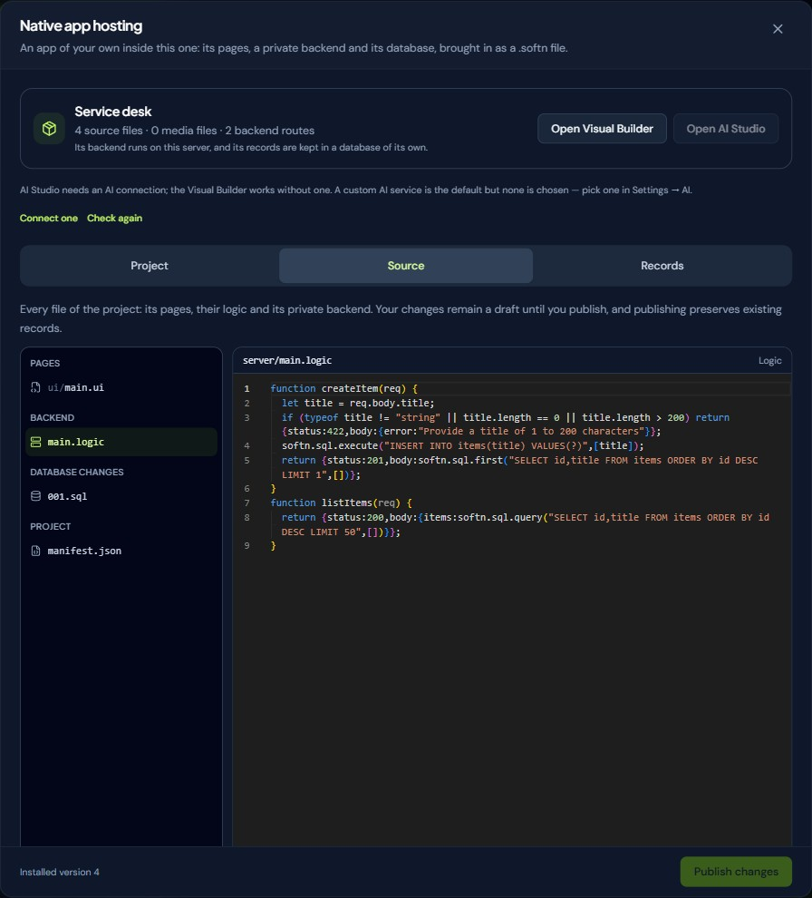
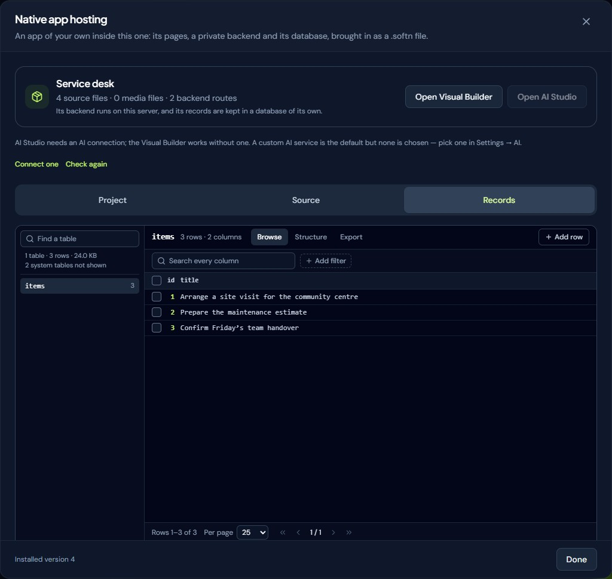
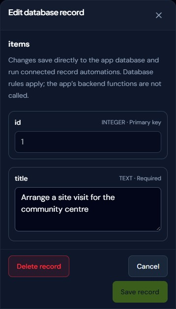

# Hosted apps and private backend actions

[Documentation home](../README.md) · [Connected dashboards and Aokie](CONNECTED_APPS.md) ·
[AI setup](FREE_PLANS_AND_AI_SETUP.md) · [MCP tools](MCP.md)

App Studio → Screens → **App hosting** hosts a text app bundle with private `.logic` actions and a separate SQLite database. The starter is a working team notes app. Edit the interface and actions, publish the project, then open Preview or `/app/<slug>/project`. Publishing a project does not change the parent app's publication status: members need an active membership and a published app. Owners can preview drafts.

## SoftN apps

A **SoftN app** is an app whose interface, private backend and database are its SoftN project,
with no forms needed (`settings.softnApp: true`). Create one with **Create app → SoftN app**, by
dropping a `.softn` file on **Apps → Import**, or by asking the chat (its `create_softn_app` tool
creates the app and takes the person to AI Studio, which builds it from their request; an MCP
client is told to build it with the native project tools, or to send the person to the app's
workspace). Its first
version is the working starter (`POST /api/apps/{id}/native/starter`, refused once anything is
installed) or the uploaded file; both are for members only and open at the app's address until
the owner changes that.

Any SoftN app can be uploaded, with a backend of its own or none:

- **No backend** (no `server` block in `manifest.json`, which is most SoftN apps): it runs in the
  member's browser alone. Nothing starts a runner for it and it has no database here, so what it
  saves stays in each visitor's browser and the **Data** tab says so. Its media are served to its
  page. Its seed data (the `.xdb` files `manifest.files.xdb` names) is kept with it, downloaded
  with it, and added to each visitor's copy before the app first draws (SoftN v0.0.28 on): once
  per record, never over a record the visitor has, and a seed record they removed stays removed.
  What a member saves stays through a session ending, in every tab and across renames of the app;
  signing out or deleting the account is what erases it, so a shared computer needs a sign-out.
  Another account never reads it. Changing who can use the app starts everyone from empty.
  Browser storage is the browser's IndexedDB (FormLogic v0.1.24 on, SoftN v0.0.33's frame): up to
  4 MB per collection, 32 MB and 1,000 keys per app, so a game's saves fit. Where a browser has no
  IndexedDB it is localStorage, at about 30,000 characters per collection (256 KB and 200 keys per
  app). A larger seed is skipped with a console warning naming it, and the app opens with the rest. It
  needs no runtime on the server: a server without the native runtime installs, publishes and
  restores it. A later version may add a backend; once a backend's migrations have run, a version
  without its `server` block is refused.
- **A backend of its own**: a `server` block with `"requires": {"apiVersion": 1, "capabilities":
  [...]}`, an `entry` under `server/` ending in `.logic`, and `"database": {"kind":
  "private-sqlite"}`. A backend written for another SoftN host (routes and an entry, nothing
  more) is refused as the file is chosen, before any app is made, with what it needs.
- **No `id`** in the manifest (SoftN makes it optional): the app runs under one named after it,
  `formlogic.app.<app id>`, as the starter does. The runner's copy of the manifest carries it; the
  project as stored and downloaded is exactly what was uploaded, so uploading the same file again
  is an update of the same app.

The name is optional: an uploaded app keeps its own (the manifest's `name`, else the file's).
The file is read as soon as it is chosen, or dropped anywhere on the form, so what it is (and any
reason it cannot be hosted, file by file) shows before anything is created. Media go under
`assets/` and can be pictures (PNG, JPEG, GIF, WebP, AVIF, ICO, BMP, SVG, HDR, EXR), sound (MP3,
WAV, Ogg, Opus, AAC, FLAC, M4A), video (MP4, WebM), fonts (WOFF, WOFF2, TTF, OTF), 3D models (glTF,
GLB and its `.bin`, OBJ, STL, FBX), and WGSL shaders, text and Markdown: what SoftN's frame serves
an app's page (v0.0.28 on), which can also `fetch` them. Scene3D draws a model from them from
SoftN v0.0.30 (before it, it refused the frame's `data:` URLs as "Unsafe model URL").

Source files are the app's pages (`.html`, or `.ui` in an app made before SoftN's HTML pages), their
logic (`.js`, or `.logic`; `.py` for Python), stylesheets (`.css`), JSON, seed data (`.xdb`), and a
backend's `server/….logic` and `server/migrations/….sql`. An app written the way SoftN writes one
now (`index.html` with `<script src="main.js">` and `<link rel="stylesheet" href="styles.css">`) is
kept as it is. Until November 2026 only the earlier spellings were, and such an app was refused
file by file. They are source text and nothing else here: the app's frame is handed them with the
rest and reads them as SoftN, the app's stored copy is under `storage/`, which is never served, and
no page of this site is made from them. Other kinds (`.htm`, `.mjs`, `.ts`, `.wasm`, a name in
capitals) are refused, with what an app is made of said in the refusal. A file name may not have
two dots together, and `apiVersion` is written `1`, not `1.0`.

The owner manages it at `/apps/<id>/softn`, a page of six sections, each at its own address so a
link or the back button lands where it was. The page itself is the **Overview**: whether the app
is live and at which version, its addresses, how much data it holds and who can use it. It starts
nothing, so looking over many apps runs none of them. **Data** (`…/softn/data/<table>/<view>`) is
the data manager described below; **Members** (`…/softn/members`, the owner alone) lists the
people who can use the app, invites others, approves or removes them, and sets how people join
(self-registration, approval, the role a new member gets): the same panels App Studio's Users &
roles step has, here on the app's own page, where the Overview's "Members" and the Settings'
"Who can use it" lead (roles themselves are still edited in App Studio);
**Edit** (`…/softn/edit`) previews the app at desktop or phone
width and changes it with AI Studio, the Visual Builder, a new `.softn` file or the source editor;
**Domains** (`…/softn/domains`) holds whether it opens at the app's address, and its own domains;
**Settings** (`…/softn/settings`, with `#settings-…` for each panel) chooses who can use it and what
it may do. The apps list (`/apps`) is one table of every app with the same facts beside each
(`GET /api/apps/summary`: the installed version, who can use it, the database's size, the connected
domain), with filters for kind and status. While the app is unpublished, a change returned from an editor is
installed at once; once it is published, changes wait as a draft (kept in this browser) until
**Publish changes**. App Studio's checklist counts a form-less app's database tables as its data, so it does not ask for a form first.

**The data manager** (the Data section, `components/data`) is the owner's view of the app's SQLite
database, in the manner of phpMyAdmin and more compact. The tables are listed on the left with
their row counts; a table opens in one of four views. *Browse* sorts by a column, searches every
shown column, filters (`is`, `contains`, `starts with`, greater and less, empty), pages 25 to 250
rows at a time and says how many rows match; a cell is edited in place (the row is read first for
its whole value and its revision, and the save is refused if the row changed meanwhile), rows are
ticked and deleted together, and a foreign-key value leads to the row it points at. A row opens
from its key, beside the grid, with the whole of every value, the rows it links to and the tables
that use it. What Browse shows (the search, the filters, the order, the page and the open row) is
held in the address's query, so a reload, Back and a copied link return to it. On a wide screen the
manager fills the page's height and its table list and rows scroll inside it, with the pager always
in view; columns keep the width of what they hold and sit together at the left. On a phone each
row is a card (a summary, which opens out to every column with an Edit beside each value) and a row
opens as a sheet over the page. The app's page is one place to the router (`lib/pagePlace`): it
stays mounted from section to section and from table to table, so an unsaved draft and the table
list keep their state, and only what changed is asked of the server. *Structure*
lists columns, indexes and the tables that point here; it is read-only, because a table's shape
comes from the app's own migrations. *Export* downloads a table, or the rows that match, as CSV or
JSON, and every table as one JSON file. *Import* brings the data from where the app ran before.
Columns that look like credentials (`NativeRecordStore::hidden()`) are never shown, searched,
sorted, filtered or exported; Structure names them and says their values are never shown. The
requests are `GET /api/apps/{id}/native/records` with `summary`, `table`, `limit`, `sort`, `dir`,
`q`, `filter`, `view=structure` and `export`, and `POST` with `deleteMany` beside the four record
actions; a caller that sends none of the new parameters gets the answers it got before.

**Files on this device** (Settings, the owner alone) decides whether the app may open the files a
person picks for it and save files they ask for, such as a saved game (SoftN's `files`
permission). **Off**, the default, grants nothing, as before. **Ask each person** shows a FormLogic
prompt before the app opens: **Allow** is remembered on that device (for a members' app, for that
member); **Not now** opens the app
without files and asks again on another visit. **Allowed without asking** is for an app the owner
knows: nobody is asked. The app's own `permission.json` asking for files is not enough: the owner's
choice is the grant (`settings.softnFiles`, `ask` or `allow`). Only a granted app's frame may
download (`sandbox="allow-scripts allow-downloads"`); it still never sees anything on the device but
what the person picks. SoftN v0.0.33's frame reads the grant; an older one grants nothing.

**Look and sharing** (Settings, the owner alone) is how the app looks before it opens and wherever it
is shared (`settings.softnLook`, AppLookService):

- **Icon**: in the tab, on a home screen and once installed. One of the app's own images; the
  default is its manifest's `icon`. A PNG, JPEG, GIF or WebP is drawn at 32, 180, 192 and 512 pixels
  (and a 512 maskable one on the loading background), so a square PNG of 512 or more suits it best.
  An SVG is used as it is, in tabs and installed apps: not by Apple's home screen or link previews,
  and served with a CSP sandbox so nothing in it runs at this site's address.
- **Share image** and **description**: what a link to the app shows. The image is fitted into
  1200 × 630 on the loading background; the description defaults to the manifest's.
- **Loading background** and **wheel**: the loading screen, a wheel and no words, from the moment
  the page opens until the app's first page is drawn (the frame says so from SoftN v0.0.34; an older
  frame is uncovered as soon as it starts). A browser that has opened the app before starts on them
  at once. An installed app's splash uses the background too.
- **Browser bar colour**: `settings.pwaThemeColor`, as for other apps.

The workspace shows the same icon wherever it lists the app (the apps table and cards, Home, the
sidebar, the app's own page header): `GET /api/apps` and `GET /api/apps/{id}` name it on a SoftN
app as `lookIcon` (`{ kind: 'raster' | 'svg', version }`, AppLookService::listIcon), for its owner
and for a member alike, and the page asks for `icon-192.png` or `icon.svg` at that version. An app
with no icon of its own carries no `lookIcon` and shows its initial. What a list is told is kept
beside the media pack for the project as installed and the owner's choices as they are, so listing
many apps reads one small file for each, not each app's source; an icon later found to be one the
server cannot draw stops being named, as the look stops naming it.

The images are served at `/api/app/{slug}/look/{name}` (`icon-32.png`, `icon-180.png`,
`icon-192.png`, `icon-512.png`, `icon-512-maskable.png`, `share.png`, `icon.svg`) to everyone the
app's manifest is for, a draft's to its owner alone; each is drawn once, without GD sent as the
original, and kept beside the media pack until the app changes. The app installs as itself from
`/app/<slug>` and from its own domain: the page names the app's manifest, which lists its own icons
and none of FormLogic's when the icon is raster. A link to `/app/<slug>` or to the domain's root,
fetched by a link-preview service (Facebook and Messenger, X, Slack, Discord, LinkedIn, WhatsApp,
Telegram, Skype, Reddit, Pinterest, Mastodon, Bluesky, Embedly, iframely), gets a page with the app's
name, description and image (AppLookController::sharePage), for a published app only and never
cached; people, and search engines, which run the page, get the app as always. The web server sends
those services there: `ui/public/.htaccess` on Apache, `ci/router.php` for PHP's own server, and on
nginx the same rule in the example in `formlogic/README.md`.

On the app's own domain the page carries the app's name from the first moment, never FormLogic's:
in the tab, as an iPhone names a home-screen icon, in the description and the titles a search engine
reads, with the domain's manifest. Three things put it there (`ui/src/lib/domainHead.ts`):

- **The backend writes it into the root page** (AppLookController::sitePage), for a first visit and
  a search engine, where the domain opens a published SoftN app at its root. The bundled
  `.htaccess` and `ci/router.php` send the root there for everyone (GET and HEAD, once `api/.env`
  exists); the rest of the site stays a file. Anywhere else the page is the file as it is, under
  the same headers, and maintenance mode lets it through. On nginx the root stays a file: a first
  visit is named a moment later, once the page has asked who the domain is.
- **`public/domain-head.js`**, before anything else on the page runs, names it from what this
  browser last heard of the domain: a reload, a page the service worker answers from its copy, an
  installed app opening.
- **The page** names it once the domain's answer comes, on a first visit to any other path.

Each keeps the site's own value beside what it gives (`data-fl-original`, `data-fl-applied`), and a
page of the domain that isn't the app's (the legal pages, a form) gets FormLogic's back.

**Adding an API backend.** An app with none (all its pages run in the visitor's browser) gets one
from its Data section (AddBackendPanel, lib/softnBackend), installed as its next version, or kept in the
draft for the owner to publish once the app is live:

- **Add a backend**: the starter's (backend/resources/native-app-starter.json): an `items` table,
  `GET` and `POST /api/items`, and the address its page calls them at (`https://app.example`,
  added to `config.server.allowedOrigins`, which this host routes to the app's own backend). The
  owner changes it in the source editor, or asks AI Studio to.
- **Add its backend from a file**: for an app built in two halves, as Coffee.Dating's hosting was (a
  public `app.softn` with the page alone, and a private bundle with its `server/` folder): the
  other file's server block, its `server/` folder (never the old host's `private/`, which may hold
  its key), the origins its page calls them at and the settings its backend reads (`config.app`,
  which the page can read too) are added; the page, its media and its own settings stay. The app
  keeps the page's `id`, or takes the file's where the page names none; a file of another app is
  refused. The same is offered when adding an app from a file that has no backend ("Add its
  backend"), and the merged app is checked against this host's limits before anything is created.


**Photos.** An app with the `photos` capability may give a route `upload: "photo"` (Coffee.Dating's
profile photos). The page sends the photo as a `data_url`; the server redraws it as SoftN's own hosts
do (Support/PhotoSanitizer, after apps/softn-host-php/runtime/photos.php): a still JPEG, PNG or WebP
of at most 4 MB and 16 megapixels, 32 to 8,192 pixels a side, read from its bytes, turned as its EXIF
says, transparency painted white, written again as a 960-pixel JPEG and a 240-pixel thumbnail with
none of the original's metadata. The backend gets `req.upload = {sanitized: true, image, thumbnail}`
and an empty body; a photo that is not taken reaches it as refused, and it answers `photo_rejected`.
`softn.config.photos` (and `/api/meta`) say whether this server can: PHP's GD with JPEG, PNG and WebP.
A photo route takes the body it and the app declare, up to 5,600,100 bytes; every other route the
2 MB it always had (NativeAppService::visitorRequest), and the page passes a request up to 6 MB to
its backend (HostedAppFrame), where every other call keeps its 32 KB; a plugin's page is held to its
2 MB as before. A photo is decoded only once its request holds a worker slot, so no more are decoded
at once than requests run. The app opens the picture through `softn.files`, so **Files on this
device** must be Allowed (or Ask) for its picker to work.


**Phone sign-in codes** (Settings, the owner alone, for an app with a backend). An app that signs
people in with a code by text names `config.app.verificationProvider: "twilio-verify"` in its
manifest, as Coffee.Dating does; SoftN leaves sending to the host's operator, and FormLogic is that
operator here (NativePhoneVerification, after Coffee.Dating's operator/verify.mjs). The owner gives
their own Twilio account SID, Verify service SID and auth token: kept in the app's private folder
(`private/verify.json`), the token sealed with the site's data key where one is set, never shown
again, and never given to the app's code, its page, a log or an answer. Then:

- `POST /api/auth/send-code` runs the backend first with `req.context.verificationProvider` set, so
  its own limits (per number, per address, overall) stand before the owner's SMS bill; only a 202
  with a `challenge_id` (stored in `otp_challenges` as `queued` with `code_hash` `verify:pending`) is
  sent, and the challenge becomes `ready` with the provider's id. A provider that cannot send fails
  the challenge (429 or 503); one replaced meanwhile is answered 409 `challenge_replaced`.
- `POST /api/auth/verify` counts the attempt on the challenge first (five at most), asks the
  provider, and tells the backend its yes in `req.context.verification` (`challengeId`, `phone`,
  `sid`, `attempt`), which the backend checks against the challenge it stored.
- Until the owner sets it up, the request is refused before the backend is asked: "Sign-in
  messaging is not configured yet." A host configuration in development (never FormLogic's own)
  passes everything through, and the app shows its own codes.

**Bringing data** (Import in the Data section, or "Bring its data too" when adding an app from a `.softn` file).
An app moved from SoftN's own hosting brings its database (`private/data/application.sqlite`) and,
optionally, that host's `private/config.json`, for the key the data was kept under: of that file
only `keyHex`, `cryptoDomains` and the app id are taken (the id must be this app's), and its Twilio
Verify details when the owner says to use them. The database is checked before anything changes:
SQLite's own file and check, no trigger, view or virtual table, no host table but the runner's
(`_migrations`, `_request_limits`, `_formlogic_record_events`, whose queued events are dropped), and
a migration ledger this version of the app lists, file for file. It is then installed as the app's
next version through the install journal (NativeAppService::importData): the app's database and
configuration are snapshotted first and put back if the app does not start on what came. Without the
key file the app keeps its own key: what the old host sealed or keyed (codes being sent at the move,
an outbox) will not read; Coffee.Dating's accounts, profiles and messages are not sealed. Stop the old
site before copying its database, so nothing is left in its write-ahead log.

Building with AI uses the person's default AI (Settings → AI). Where it cannot answer yet, the

page says why and offers **Use FormLogic Site AI** in one click when the operator offers Site AI,
beside connecting their own; the Visual Builder and uploads never need AI. The editor's own save
button takes FormLogic's name for it (**Save changes**, or **Keep changes** once the app is live),
so the two buttons agree.

## App AI, visitors and payments

A SoftN app's server can ask FormLogic's AI for pictures, picture edits and chat replies, and charge
its visitors small amounts from a prepaid balance. Visitors need no account. Nothing changes for an
app that does not ask: no cookie, no header, and `req.context` exactly as before.

### What an app declares

Two FormLogic-only sections of `manifest.json`, like a plugin's `formlogicPlugin`. FormLogic shows
them before the app is installed, holds them to these rules at install (AppFormlogicManifest), and
takes them out of the page's copy of the manifest.

```json
"formlogicAi": {
  "uses": ["pictures", "picture-edits", "chat"],
  "purpose": "Draws logos from a short brief, and talks them through.",
  "jobs": { "table": "ai_jobs", "deliver": "/api/site/ai/deliver" }
},
"formlogicPayments": {
  "purpose": "Pay 5¢ to download a logo.",
  "items": [ { "id": "download", "label": "Download a logo", "priceCents": 5 } ],
  "routes": [ "/api/download" ]
}
```

- `uses`: any of `pictures`, `picture-edits` and `chat`. `purpose`: one sentence (up to 200
  characters) that the owner and the app's visitors are shown.
- `jobs.table`: the table the app's server writes its AI jobs into. `jobs.deliver`: the route
  FormLogic posts results to. It must be under `/api/site/` and declared as a POST route of the server.
- `items`: up to 20 things the app charges for, each with an id (lower-case letters, digits, `-` and
  `_`), a label and a price of 1 to 500 cents. `routes`: the POST routes that may ask for a charge.
- Both need the app's own backend (a `server` block).

**`/api/site/` is FormLogic's.** A page never calls a route under `/api/site/`, for any app: the
runtime answers 404 before the app's backend is asked. FormLogic itself calls them (App AI's
deliveries, a plugin's camera check).

### Visitors

An app that declares either section is given FormLogic's **visitors**: people with no account, known
by their browser.

- **The cookie.** The browser holds a secret in an HttpOnly cookie the server sets
  (`formlogic_visitor`: `HttpOnly; SameSite=Lax; Path=/api/`, 400 days, `Secure` where the site's
  cookies are, host-only). Script cannot read it, and Safari's seven-day sweep of script-written
  storage does not touch it. The runtime GET sets it, or renews its age, once a page load.
- **The marker.** It counts only on a request FormLogic's own page marked with
  `X-FormLogic-Visitor: 1`, from the site's origin or the app's own domain. A custom header needs
  CORS's preflight, so no other site can send it. FormLogic's CSRF check covers only requests with the
  sign-in cookie; this is the check for visitors.
- **The id.** Each app sees its own id for a browser (32 hex characters): the same browser cannot be
  followed from one app to another. The key that signs the cookie is the site's, kept in the database
  (`system_meta`), and is not derived from `JWT_SECRET`.
- **One browser, one origin.** The app at `/app/<slug>` and on its own domain are two visitors.
  Clearing cookies starts a new one.

What the app's backend sees (`req.context.formlogic`):

| Field | When |
|---|---|
| `appId` | always, for an app that declares either section |
| `userId`, `roleId` | a members-only app, as before |
| `visitor: {id}` | an application-access app, on a request FormLogic's page marked |
| `owner: true` | an application-access app, on a request from the app's owner while they are signed in to FormLogic; absent otherwise, never `false` |
| `addressKey` | every request from the app's page, for an app that declares either section: a member's, a visitor's, and one nobody marked; absent when the address is not known |
| `ai: {enabled, source, label, uses, perDay, usedToday, ipPerDay, ipUsedToday, jobs, requester?, reason?}` | an app that declares `formlogicAi` |
| `ai: {delivery: true, requester}` | FormLogic delivering a result to the app's deliver route |
| `wallet: {available, balanceCents, currency, items, reason?}` | an app that declares `formlogicPayments` |
| `payment: {chargeId, item, amountCents, status, code?, balanceCents, alreadyPaid}` | a charge's second run (see [App payments](#app-payments-a-prepaid-balance-and-a-charge-in-two-runs)) |

**`ai.requester` is who is asking**, as App AI counts them: `u-<member id>` or `v-<visitor id>`, an
opaque id, the same for one person in one app on their own requests and on the delivery of their
jobs. It is absent when nobody is known (a request no FormLogic page marked). An app can keep it on
a job's row to know whose job a delivery is.

**`owner: true` is the app's owner, on an app anyone may open.** A public app has no members, so
without it the owner could not reach the app's own settings once the app is public. FormLogic says
it from the sign-in alone: the request carries the owner's FormLogic session, and, as every
signed-in request must, that session's CSRF token (a request with the sign-in cookie and no token is
refused before the app is asked anything). Nothing the page sends makes an owner: no header, no body
field. Nothing else of the owner is said: there is no `userId`, and who asks for AI and whose wallet
it is stay the browser's visitor, so an owner trying their own app is counted and charged as any
visitor is. A members' app does not get the field: there the owner is `roleId: "owner"`, as always.
An app that declares neither section gets no `formlogic` at all, for its owner as for anyone. An
owner who is signed out, or in another browser, is a visitor like any other: show them nothing an
owner sees, and let them sign in to FormLogic and come back.

**`addressKey` is the address a request came from, as the app may count it.** A visitor is a cookie:
clearing it, a private window, or a script that never keeps it makes a new visitor on every request,
so a limit counted per visitor alone bounds one honest browser and nothing else. For its own limits
(free rounds a day, stored designs, uploads) an app counts by `addressKey` as well, as FormLogic's AI
limits count by address.

- **What it is.** An opaque string of 32 hex characters: the same for every request from one address
  to this app, and different in every other app, as a visitor's id is, so an address cannot be
  followed from app to app. An IPv6 address counts by its /64, since one subscriber is handed a whole
  /64; an IPv4 address reported as IPv6 (`::ffff:…`) is that IPv4 address. It is a keyed hash, made
  with the site's key that signs visitors' cookies: the address itself is never given, and cannot be
  worked back from it.
- **When it is there.** On every request from the app's page: a member's, a visitor's, and one
  nobody marked, so the app can count or refuse those too. It is absent when FormLogic knows no
  address for the request, so an app can tell "no address" from an address: count such a request per
  visitor, or refuse it. FormLogic's own calls to `/api/site/` (a delivery) come from no visitor and
  carry none.
- **How long it lasts.** Nothing goes into it but the site's key, the app's id and the address, so it
  is the same tomorrow and next year. Only replacing the site's key (`system_meta`,
  `app_visitor_key`) changes it, and then every count kept by it starts again.
- **Nothing the page sends sets it**: no header, no body field. It is the connection's address as
  FormLogic reads it, so it is only as good as the site's `TRUSTED_PROXIES` setting: behind a proxy
  without it, every visitor has the proxy's key (see [Before going live](#before-going-live)).

**Decide "FormLogic member" by `userId`, not by `formlogic`.** An app that declares these sections
gets `req.context.formlogic` without a `userId` for its visitors. Coffee.Dating, which declares
neither, reads any `formlogic` it is given as a member, and so it is given none: its context stays
`{}`.

### App AI: asking for a job

The app's server inserts a row into its jobs table. FormLogic gives that one request a record-event
subscription for the table, so the insert is captured in the write's own transaction: a write that
rolls back (an exception, or an answer with `rollback: true`) asks for nothing. An answer of 400 or
500 **without** `rollback: true` still commits, and its job is taken.

| Column | Meaning |
|---|---|
| `id` | TEXT PRIMARY KEY, up to 100 characters: the job's id in deliveries |
| `kind` | `picture`, `edit` or `chat`; it must be one of the app's `uses` |
| `prompt` | a picture or edit's prompt, up to 4,000 characters |
| `size` | `512x512`, `768x768`, `1024x1024` (the default), `1024x768` or `768x1024` |
| `seed` | optional, 0 to 9007199254740991 (2^53 − 1); without one, the AI picks one and the delivery reports it |
| `reference` | an edit's picture: a PNG, JPEG or WebP data URL of at most 2 MB |
| `messages` | a chat job's JSON list of 1 to 24 `{role: system/user/assistant, content}`, up to 16,000 characters |
| `max_output` | optional, a chat job's longest answer in tokens: a whole number, 1 or more (below) |
| `status` | optional and the app's own, but setting it to `cancelled` cancels the job (below) |

Other columns are the app's own. The model is never the app's choice: the owner or the
administrator pins it. FormLogic reads the whole row after the commit, once per event, checks it,
counts it and queues it.

**How long a chat's answer may be.** A chat job's answer has a length in tokens: its row's
`max_output`, held to the administrator's ceiling (Admin → Platform → AI for apps → Limits and
safety, **Longest chat answer**: 2,000 tokens to start with, 16 to 8,000), which is also the length
when the row gives none. More than the ceiling is not an error: the job is taken and held to it.
Anything but a whole number of 1 or more is `bad_request`.

- The length goes to the AI as the answer's limit: `max_tokens` to the `.env` upstream, `maxTokens`
  in the sealed chat request to an OAIY computer.
- FormLogic also stops reading: it keeps at most eight characters for each token (a token is about
  four, so an answer within its tokens is never cut), and never more than 32,000. On an OAIY
  computer, where the answer arrives as it is written, one that runs past that is ended there: the
  job is delivered `done` with what was read, and the computer is told to stop
  ([Cancel reaches the computer](#app-ai-where-it-runs-and-what-the-app-is-delivered)). So an AI
  that does not know the limit, or ignores it, cannot run on. The `.env` upstream is asked for its
  answer whole, so there the answer is cut to that length when it comes, and one that never ends is
  given up on after two minutes (`timeout`).
- An app that reads only the start of an answer (one JSON object, say) should ask for no more
  tokens than that takes: the rest is the computer's time, and the next job waits for it.

**Always an answer.** Every request of an app that declares AI carries the subscription, whatever its
AI can do at that moment, so no row waits forever. A job FormLogic cannot take is still taken,
refused, and answered at once with a `failed` delivery carrying its code: `ai_off`, `ai_paused` (the
site's pause, or the app's AI resting after five failures), `ai_unavailable` (no AI set up for it,
its computer gone, or a request no FormLogic page marked, so nobody is known to have asked),
`limit_reached`, `busy` (too many waiting), `prompt_refused` (a word the site does not allow) or
`bad_request` (a malformed row). A refused job is not counted.

**Cancelling a job.** The app cancels a job by setting its row's `status` to `cancelled`, or by
deleting the row, in a request from its page: FormLogic captures the jobs table's
`app.record.updated` and `app.record.deleted` events through the same subscription. A job still
waiting is dropped; one already sent is cancelled on its computer (a request the computer has not
taken is withdrawn; one being drawn or written frees its place at once, and the computer is told to
stop on its next frame: [Cancel reaches the computer](#app-ai-where-it-runs-and-what-the-app-is-delivered));
one whose result is back but not yet delivered is not delivered. Each gives its use back. A row set
to `cancelled` is told so once, `{jobId, status: "cancelled"}`; a deleted row hears nothing. A job
already answered stands. Any other change to a row is not a cancel.

Every dispatcher (the runtime request, the owner's records API, `bin/native-record-dispatch.php`)
hands an event to NativeRecordEventRouter, which gives App AI its `fl-ai-…` bindings and the flows
the rest; RecordEventRouterWiringTest holds them to it. When another process holds an app's events
lock, the request leaves its event for the next dispatch.

**Limits**, counted when a job is taken and given back when it fails without a result:

| Limit | Default |
|---|---|
| Per requester (a visitor or member) per day | 10 |
| Per address per day (an IPv6 address by its /64): the "free rounds" | 20 |
| Per address per hour | 10 |
| Per app per day | 500 |
| All apps on the site's AI per day | 2,000 |
| Waiting per app; waiting or running per requester | 20; 2 |

Addresses are kept only as a keyed hash. They are only as good as the site's
`TRUSTED_PROXIES` setting (see [Before going live](#before-going-live)).

### App AI: where it runs, and what the app is delivered

**The owner chooses.** An app that declares `formlogicAi` has **AI for this app** in its Settings section:
off (the start), **this site's AI** (where the administrator offers it, Admin → Platform → AI for
apps), or **their own OAIY** (below). The owner sets the limits above, within the administrator's
ceiling for apps on the site's AI, and a **Test** button runs a real small job (a 512 px picture, or a
five-word chat), counted in the app's day, kept for the owner for an hour and never delivered to the
app; its picture is shown there with the time it took, or the reason it failed and what to try. An
administrator acting as the owner may look but not change it.

- **How it is doing** is said at the top, and again beside **Save**: ready, busy ("1 being made, 3
  waiting"), offline since when, paused, stopped, or off. `GET /api/apps/{id}/ai` gives it as `status`
  (`state`, `running`, `waiting`, and `offlineSince` while the computer has not been heard from).
- **Why "Use this site's AI" is not there** is said in plain words: the site does not let apps use its
  AI yet, has no AI set up, lost the computer it ran on, has paused AI for apps, or has no picture
  model chosen (chat only, for now). The same answer has it as `site`: `{offered, working, reason,
  kinds, missing}`, `reason` one of `site_ai_closed`, `site_ai_unavailable`, `site_ai_gone`,
  `ai_paused`, or `model_unset` or `no_pictures` when pictures are all the app asks for; `missing`
  (`{kinds, reason}`) is what the app asks for that a working site's AI cannot do yet. An
  administrator gets a link, **Set up the site's AI**, to the card that fixes it; anyone else is told
  to ask one.
- **"This app can use AI. Set it up."** While the app declares `formlogicAi` and its AI is off, its
  owner sees this one line at the top of the app's own page in FormLogic (the workspace), leading to
  the panel. It can be dismissed, for that app in that browser, and is never shown to a manager, a
  member or a visitor.

**The administrator sets the site's AI up** with the checklist at the top of Admin → Platform → AI for
apps ([AI for apps](FREE_PLANS_AND_AI_SETUP.md#ai-for-apps)): a computer, the site's AI on it, apps
allowed, a picture model from the computer's own list, and a test picture. `GET /api/admin/app-ai`
carries what it shows as `setup`: `source` (`computer`, `env`, `gone` or `none`), the `computer` (with
`online` and `lastSeenAt`), `provider` (`named` in the server's settings, and `on`: the Site AI
switch), `kinds` the site's AI takes now, `worker`, `ready` (apps can make pictures: everything is
set and a worker runs to send their requests), and `lastTest`. `POST /api/admin/app-ai/test` `{kind:
"picture" | "chat"}` queues the administrator's own test (202, `{data: {jobId}}`; 20 an hour, one at a
time, with the confirmation every administrator's change needs), and `GET /api/admin/app-ai/test/{job}`
follows it: `queued` (with `waiting: "computer"` while the computer is offline), `running`, `done`
with the picture or the reply, or `failed`. The test is a job like an app's, sent by the same worker
to the same place, but it is no app's (`app_ai_jobs.app_id` is null): it is never delivered, counts
against no allowance, and runs whether or not apps are allowed or paused.

- **The worker, on the card.** `setup.worker` is `{state, idleSeconds, mode, message}`. `missing`: no
  worker has made a pass for two minutes ("The AI worker isn't running. Start it: …"). `stale`: one
  runs, but its heartbeat says it loaded other code than is on the server now ("The AI worker was
  started before the last update. Restart it."). The card says it above the steps, `ready` is false,
  and the test is not queued: `POST …/test` answers 409 `worker_missing` or `worker_stale` with the
  same sentence. A test already waiting when the worker stops reads `waiting: "worker"` with
  `workerMessage`.
- **A failed test is told in the administrator's own words**, never an app's: `code`, `message` and
  `advice`. What can change while a test waits has a code and a sentence of its own:
  `site_ai_unavailable` (the site's AI was switched off or changed), `site_ai_gone` (the computer was
  unlinked or re-keyed), `model_unset` (the picture model was cleared), `no_pictures`, `expired`.
  `worker_outdated` is a test taken by a worker running older code, which ended it as an app's job
  with no app: restart the worker. What the AI itself refused (`model_disabled`, `model_unknown`,
  `engine_failed`, `timeout`, `busy`) is told as it said it, with what to try in `advice`.

**The worker** (`bin/app-ai-worker.php`, AppAiWorker) sends the jobs and delivers the results. Run it
every minute from cron (each run works for about 55 seconds and finishes what it started), or under a
supervisor with `--watch`:

```
* * * * * cd /path/to/formlogic/backend && php bin/app-ai-worker.php >> logs/app-ai-worker.log 2>&1
```

- **It never outlives an update.** A worker keeps the code it started with, and one left running
  through an update fails what the new code asks of it. So before every pass it reads the code's
  fingerprint on disk again (CodeFingerprint: the size and time of every PHP file under `src/`,
  `config/` and `bin/`, and Composer's list; it differs after any update of the server's code, with
  or without a schema change). When it differs the worker takes nothing new, finishes what it has in
  hand, logs `FormLogic was updated; stopping so a fresh worker starts` and exits with status 75. A
  cron run is fresh every minute. `--watch` belongs under a supervisor that starts it again whenever
  it exits (systemd `Restart=always`, supervisord `autorestart=true`); see [DEPLOYMENT.md, "Every
  scheduled job"](../DEPLOYMENT.md#every-scheduled-job). Its heartbeat
  (`storage/app-ai/results/.alive`) holds the fingerprint it loaded and whether it is `watch` or
  `cron`, which is how the administrator's card tells a stale worker from a missing one.

- **Where a job goes.** The app's choice when the job is sent: the site's OAIY computer (Admin →
  Platform → Plans & AI → Serve it from your OAIY), the owner's own (**Use my OAIY**), or the `.env` upstream
  (`AI_BASE_URL`, in Studio's gateway form: `POST /images/generations`, an edit's picture as
  `images: ["data:…"]`, `incognito: true` and `X-OAIY-Incognito: 1`).
- **A computer that is gone is not chosen.** The site's computer, once it is unlinked, gets a new key
  (OAIY reinstalled) or its administrator loses the role, reads as unmade: members' Site AI and apps
  are not sent to it, and **nothing is sent to the `.env` upstream in its place** (members are told
  `site_ai_gone`; apps' `ai.reason` is `site_ai_gone`), the administrator's card says which computer it
  was, and jobs waiting for it are answered `ai_unavailable` with their uses given back. The `.env`
  upstream serves only when no computer is chosen: an administrator who wants it presses **Forget it**
  (or Stop). An owner's own computer is the same (`own_changed`).
- **One picture at a time on a computer, and a chat beside it.** The desktop AI lane gives pictures
  (`kind: "image"`) a claim of their own, so a computer holds one picture and one request of any other
  kind; a picture never takes one of the members' three chat places. App AI's own requests are queued
  as the app's owner but never take the owner's own two places (`desktop_ai_requests.source =
  'app-ai'`). The `.env` upstream takes one picture and two chats at once.
- **Fair turns.** On each computer the app served least recently goes first, then within it the
  requester served least recently, then the oldest job. A job waiting 30 minutes runs out
  (`expired`).
- **Cancel reaches the computer.** When a request a computer is working on is no longer wanted (its
  app cancelled the job, the job ran out of time after 15 minutes, a chat's answer ran past its
  length, or the lane let it go as silent or too old), its place on the lane is free at once, and
  FormLogic answers the computer's next frame for it (`POST /api/v1/desktop-ai/{id}/frames`:
  progress, partial or final alike) and its outcome (`…/complete`) with

  ```
  HTTP 409
  {"error": true, "message": "This request was cancelled. Stop the work and send nothing more for it.", "code": "cancelled"}
  ```

  A computer that reads `code: "cancelled"` stops the work (OAIY cancels the picture at its engine,
  or the chat's generation), sends nothing more for the request and frees its own slot. Only the
  computer that held the request is told so; any other, and a request already finished, is answered
  `not_claimed` as before. Before this, a cancelled picture was drawn to its end and the next one
  waited behind it.
- **A picture being drawn is kept alive** by OAIY's progress frames, about every 5 seconds (which is
  also how soon a cancel is heard); one silent
  for 5 minutes is let go. A job that never reached the AI, or whose answer was lost (a restarted
  worker carries on from the job's row: the turn's key is kept there, sealed with
  `DATA_ENCRYPTION_KEY` where one is set), is sent once more. OAIY's `busy` (Studio's own queue full)
  is tried again up to four times, 30 seconds apart. Five failures of the AI in a row rest the app's AI
  for 10 minutes (`ai.reason: "ai_resting"`).

**Use my OAIY.** The owner picks one of their own linked computers that has published its chat key
(their only one is picked for them; with none, an always-on `oaiy-server` links with **Connect an OAIY
server**, right there, and a desktop from Settings → AI & devices), and the picture model its engines
draw with, listed by asking the computer as soon as it is picked (`GET /api/apps/{id}/ai/models?connectionId=&providerId=oaiy-engine`,
and `…/ai/providers?connectionId=`), with `flux-3-image-klein` suggested where it has it. While the
computer is offline the model's name is typed. The computer is pinned to the key it published: if it is
unlinked or gets a new key, the app's AI is off (`ai.reason: "own_changed"`) until the owner chooses it
again. Its jobs are queued as the owner, so their own computer serves them whether or not they are an
administrator, with the same lanes, fair turns, limits and log as the site's AI; the owner's apps share
the computer fairly. Its chat answers with the model chosen in OAIY. It spends none of the site's day
(**Requests a day, every app together**), and the app's limits are the owner's to set, with no
ceiling from the site's AI; the administrator's pause, a stop for one app and the words a prompt may
not use still apply.

**The delivery.** FormLogic posts each result, as the site, to the app's `jobs.deliver` route, with
`req.context.formlogic.ai.delivery === true` and `ai.requester` naming who asked for the job
([Visitors](#visitors)). Every try of one delivery carries the same `idempotency-key: fl-ai-<FormLogic's
job id>` header, so the app can tell a retry from a second result.

```json
{ "jobId": "<the row's id>", "status": "done",
  "picture": "data:image/jpeg;base64,…", "mimeType": "image/jpeg", "width": 1024, "height": 1024,
  "seed": 1873465, "model": "flux-3-image-klein" }
{ "jobId": "<the row's id>", "status": "done", "text": "…", "model": "…" }
{ "jobId": "<the row's id>", "status": "failed", "code": "model_disabled", "message": "…" }
{ "jobId": "<the row's id>", "status": "cancelled" }
```

- **The picture** is redrawn by FormLogic (GD) and is at most 1,500,000 bytes as a data URL, so the app
  can keep it in one SQL call and send it to its page in one answer. A JPEG comes back a *baseline*
  JPEG of at most 1024 px; a PNG stays a PNG while it fits (1024, 896, then 768 px) and is otherwise a
  baseline JPEG at 1024 px. Never WebP, never progressive.
- **`code`** on a failure: `model_disabled` (switched off, or its files are missing: the
  administrator is warned), `model_unknown`, `busy`, `bad_request`, `too_large`, `engine_failed`,
  `timeout`, `expired`, `ai_off`, `ai_paused`, `ai_unavailable`, and for a job refused when it was asked
  for, `limit_reached`, `busy`, `bad_request` or `prompt_refused` ([Always an answer](#app-ai-asking-for-a-job)).
  A job that fails without a result gives its use back. `status: "cancelled"` answers the app's own
  cancel, once.
- **Retries.** An answer of 2xx takes the delivery. A busy app (409, 429, 503, or no answer) is asked
  again after 5 s, 15 s, 1, 5, 10 and 15 minutes; any other answer is tried three times. A result
  never taken is dropped (`undelivered`).
- **A follow-up job.** While it handles a delivery, the deliver route may write **one** new row in
  the jobs table, and FormLogic takes it as a job for the delivered job's requester: a chat's answer
  that is a plan can ask for the picture at once, whether or not the person's page is still open.
  - It is theirs in every count: their day's allowance, their two open jobs, their address (the one
    the delivered job was asked from) and the app's day, as if their page had asked. A limit reached
    answers it `failed` with the usual code (`limit_reached`, `busy`, and the rest of
    [Always an answer](#app-ai-asking-for-a-job)).
  - One for a delivered job, whatever became of it. A second row written by the same delivery (or by
    another try of it) is answered `failed`, `limit_reached`: "One follow-up job may be asked for
    while a job's result is delivered…".
  - None from the delivery of a follow-up: a row written there is answered `failed`,
    `limit_reached`, "A follow-up job's delivery cannot ask for another job." Rows written while
    those refusals are delivered are not jobs at all (nothing answers them), so a chain ends by
    itself however the route is written.
  - Only a new row counts. A delivery that updates or deletes a jobs row cancels nothing (a cancel
    comes from the person's own page), and no flow hears of what a delivery writes.
  - The app charges its own credits as it does now, and can tell whose job it is by
    `ai.requester`, which is the same on the delivery as it was on the request that asked.
- **Queue positions** are not delivered: every request of the app sees its requester's open jobs in
  `req.context.formlogic.ai.jobs`, by the row's id: `{status: "queued", lane, position, waiting}` or
  `{status: "running", lane}`. `lane` is `picture` (pictures and edits) or `chat`; `position` counts
  the jobs ahead of it in that lane on the same computer (or the `.env` upstream); `waiting` is
  `queue` (its turn has not come) or `computer_offline` (the computer it waits for has not been heard
  from in 90 seconds). Members see this for their own jobs, as visitors do.

**What is kept.** A job's prompt (and an edit's picture) 30 days, the job 90, the day's counts three
days, a result until it is delivered (a test's an hour): `bin/privacy-sweep.php` and the worker clear
them.

### App payments: a prepaid balance, and a charge in two runs

An app that declares `formlogicPayments` can charge its visitors (or members) a few cents from a
balance they top up through **this site's PayPal**. The money is the site's, so in this version only an
**administrator's app** takes payments, and only while the administrator's **App payments** switch,
the Plans payments switch and PayPal are all on and `BETA_MODE` is off. PayPal counts as on with its
credentials and `PAYPAL_WEBHOOK_ID` (without the webhook, refunds and disputes would never reach a
wallet), and never with `PAYPAL_BASE_URL` set outside `APP_ENV=development` (a stand-in's address
there makes payments unavailable). The owner confirms (or lowers) each item's price and turns
payments on in the app's **Payments** settings; the price charged is the owner's, never a number the
app sends. An item an app update adds is not sold until the owner saves its price.

**What the app sees** on every request (`req.context.formlogic.wallet`):
`{available, balanceCents, currency: "USD", items: {<item>: <cents>}, reason?}`. `reason` says why
payments are off (`beta`, `payments_disabled`, `app_payments_off`, `paypal_unconfigured`,
`owner_not_admin`, `app_off`, `visitor_required`, `wallet_blocked`, `wallet_disputed`).

**A charge** happens on one of the POST routes the manifest lists under `routes`, in two runs of
that route within one request:

1. **The ask.** The route answers `402` with `{formlogicCharge: {id, item}}` and `rollback: true`,
   writing nothing. `id` names what is bought (`download:<designId>`), 1 to 100 of
   `A-Z a-z 0-9 _ . : -`; `item` is one of the manifest's items. A route that needs no charge (the
   visitor bought it already, by the app's own records) just answers, and that answer goes back.
2. **FormLogic decides**: the payer is whoever made this request, the price the owner's for the item.
   It debits the balance atomically, once per charge id. The charge is **pending**, then **running**
   once the second run starts, until that run answers: the same id from another request meanwhile is
   declined `in_progress` (ask again in a moment); once settled, the same id is `alreadyPaid`, for its
   own item only (another item under it is declined `charge_conflict`).
3. **The second run** carries `req.context.formlogic.payment`
   `{chargeId, item, amountCents, status: "paid" | "declined", code?, balanceCents, alreadyPaid}`.
   Its answer is the one the page gets. `code` on a decline: `insufficient_funds`, `limit_reached` (the
   wallet's day), `wallet_blocked`, `payments_off`, `unknown_item`, `price_unconfirmed`, `bad_charge`,
   `price_too_high`, `visitor_required`, `in_progress`, `charge_conflict`. Both runs hold one worker
   slot from the first to the last, so a second run is never turned away busy after a debit.

**Rules for the app's author:**
- Make the charge id the thing being bought, so a retry completes the purchase (`alreadyPaid`) and
  never pays twice.
- In the second run, answer **2xx when you have delivered what was bought**. A paid charge is
  **given back** only when that run committed nothing: it threw and the runtime rolled it back (the
  runtime says so on its own error channel; an answer that only looks like its `host_error` keeps the
  charge, since the app writes its answer), it never started (the app updated meanwhile, no worker
  free, the runtime unable to start), it asked to charge again, or it said so itself with
  `formlogicRefund: true` in its body **and** `rollback: true` (out of stock, say). Any other answer
  keeps the charge, whatever its status, and so does a run that timed out or whose answer was lost: it
  may have written the sale, and a retry with the same charge id is `alreadyPaid`, and delivers. A
  charge whose request died is settled after 15 minutes if its second run had started (the runner
  outlives a PHP worker, so the sale may be written) and given back if it had not.
- Ask once per request: a second ask in the second run is never charged, and the page is told the
  request failed.
- On a decline the page opens FormLogic's wallet: `softn.backend.call("formlogicWallet", {op: "open"})`.
  It opens over the app (a frame can have no PayPal of its own) and answers when the person closes it:
  `{closed: true, balanceCents}`. The app never sees the wallet itself.

**The wallet sheet** shows the balance and its latest lines, the top-ups the administrator offers
($2 at least), PayPal's buttons, and, where the site can send email, **Save my balance with an email**
and **Restore a saved balance**: a six-digit code sent to the address joins this browser to the
balance saved under it. Only a keyed hash of the email is kept. A code is good for five guesses and one
use, counted atomically; a restore asked for an address no balance is saved under is answered, and
mailed, the same way. A held balance (disputed, or below zero) is not moved until that is settled.
Its routes, for FormLogic's own page:
`GET /api/app/{slug}/wallet`, `POST …/wallet/orders {cents}`, `POST …/wallet/orders/{orderId}` (capture),
`POST …/wallet/email {purpose: save|restore, email}`, `POST …/wallet/confirm {purpose, email, code}`;
a visitor's carry `X-FormLogic-Visitor: 1`, as the app's own requests do.

**Paying on a development site.** PayPal's own buttons cannot work against a stand-in for PayPal
(`PAYPAL_BASE_URL`, taken only when `APP_ENV` is exactly `development`): PayPal's script knows
neither the stand-in's client id nor its orders. So there the sheet's answer carries
`paypalStandIn: true`, and the sheet shows one button of its own, **Pay with the stand-in PayPal**,
under a line saying that no money moves, and never loads PayPal's script. The button does what
PayPal's do, with the approval a buyer gives in PayPal's window made at the stand-in:
`POST …/wallet/orders {cents}`, `POST …/wallet/stand-in/{orderId}` (FormLogic approves the person's
own pending order at the stand-in), then `POST …/wallet/orders/{orderId}` to capture it. On any site
whose PayPal is PayPal, `paypalStandIn` is false and `…/wallet/stand-in/…` answers 404.

To set a development site up for it: `APP_ENV=development`, any `PAYPAL_CLIENT_ID`, `PAYPAL_SECRET`
and `PAYPAL_WEBHOOK_ID`, `PAYPAL_BASE_URL=http://127.0.0.1:8306`, and the stand-in started beside it
(`php -S 127.0.0.1:8306 formlogic/backend/tests/Support/stub-paypal-server.php`); then the switches
of [App payments](#app-payments-a-prepaid-balance-and-a-charge-in-two-runs) as on any site. The
stand-in sends no webhooks: to see a refund or a dispute reach a wallet, post the event to
`/api/billing/webhook/paypal` with `PayPal-Transmission-Sig: stub-valid`, which is the one signature
the stand-in vouches for. A test suite's visitors all come from one address, so there, and only
there, `APP_WALLET_TOPUPS_PER_HOUR` may raise the five top-ups an hour a wallet and an address get.

**The ledger.** Every top-up, charge, refund, transfer and correction is a ledger line written with
the balance, in one transaction. A top-up is credited once (the capture call and PayPal's webhook,
whichever comes first), to the wallet its holder has when it is credited. Each refund or reversal in
PayPal takes back its own amount once, by its id, below zero if it was spent, and the wallet is then
held until a top-up settles it; a dispute holds it until every dispute on its top-ups is resolved.
Five top-ups an hour per visitor and per address; five email codes an hour per address and
a day per email. Money records never cascade: they outlive the app and its visitors' accounts.

### Connecting an OAIY server

An always-on OAIY server (`oaiy-server`) has no browser to approve the usual link, which redirects to
`127.0.0.1` on the machine itself. It links with a one-time code instead (DesktopLinkCodeService),
from **Connect an OAIY server**: in Settings → AI & devices → Linked desktops, in the administrator's
Site AI card, and in an app's AI settings under **Use my OAIY**.

1. Choose what the server may do: **AI only** (the default) or **Everything a linked desktop can do**.
   Optionally name it. FormLogic shows a code (twelve characters, `K7QM-2WXR-9DFT`) once, good for ten
   minutes and one use, and the command to run.
2. On the server: `oaiy-server link --code <code> --base-url <this site> [--name <device>]`.
3. The page shows it linked. Start (or restart) `oaiy-server`, and it is an ordinary linked computer:
   it checks in, publishes its chat key and takes the AI lane's requests.

| Request | Who | What |
|---|---|---|
| `POST /api/desktop-links/codes` `{scope: "ai"\|"all", deviceName?}` | signed in | `201 {data: {id, code, expiresAt, scope, baseUrl, command}}`; at most 3 waiting codes an account (`409 desktop_link_too_many`) |
| `GET /api/desktop-links/codes/{id}` | signed in, its maker | `{data: {status: waiting\|linked\|unlinked\|expired\|failed, connectionId?, deviceName?, message?}}`; `unlinked`: the computer it linked has been unlinked since |
| `POST /api/oauth/oaiy-link` `code`, `device_name?` (a form or JSON) | public, 10 a minute an address | exactly the browser link's token answer: `{access_token, token_type, scope, formlogic_api_key, api_key_id, desktop_connection_id, device_name}`, `Cache-Control: no-store` |

An unknown, expired or spent code answers alike: `400 {error: "invalid_grant", error_description}`.
Only the code's keyed hash is kept. Both links mint through one issuer (DesktopLinkIssuer), so they
answer alike byte for byte, and both are revocable as any linked computer is.

**AI only.** Such a link's key holds `connector:relay` and is marked AI-only (`api_keys.ai_only`). It
answers the AI lane (`/api/v1/desktop-ai/*`) and checks in, and nothing else:

- connector and plugin commands are never routed to it: it is no candidate for a connector, a pin or a
  Backups link, so an AI server beside your desktop never makes routing ambiguous; its command poll
  is refused at once (`403 insufficient_scope`, never a held long poll), and so are its claims
  (`403 ai_only_link`);
- it runs no sealed desktop flows (`/api/v1/desktop-flows/*` answers `403 insufficient_scope`);
- it cannot enrol as a storage node (`/api/v1/data-node/*` answers `403 insufficient_scope`).

Every link made before this keeps exactly what it had: only a key marked AI-only is held to this, and
the older keys that hold `connector:relay` alone keep their grandfathered access.

### Before going live

Five things for the site's owner, before the public uses an app's AI or pays through it:

1. **The picture model's licence.** A model's terms decide whether its pictures may be sold. FLUX 3
   Image Klein, for one, is under the FLUX Kommunity License: non-commercial, with commercial use of
   its outputs for qualifying users. Check that the site qualifies before downloads are charged for.
2. **The address behind a proxy.** Per-address limits (an app's free rounds) are only as good as the
   address FormLogic reads. Behind Cloudflare, or any proxy, set `TRUSTED_PROXIES` to the proxy's
   ranges ([Cloudflare's](https://www.cloudflare.com/ips/), plus any proxy of your own in front of
   PHP) and `TRUSTED_PROXY_HEADER` to `X-Forwarded-For`: Cloudflare adds the visitor's address to it,
   and FormLogic reads the last address that is not a trusted proxy. Without them every visitor reads
   as a handful of proxy addresses, and their free rounds become one shared allowance. Admin →
   Platform → AI for apps warns when the administrator's own request arrives from Cloudflare's ranges
   (or with Cloudflare's `CF-Connecting-IP` header) while `TRUSTED_PROXIES` is unset.
   An app's own limits go the same way: what it counts by `req.context.formlogic.addressKey` (its
   free rounds a day, say) is counted against those same few proxy addresses, so behind a proxy
   without `TRUSTED_PROXIES` each of an app's per-address limits is one allowance shared by everyone.
3. **One real PayPal sandbox run.** The tests use a stub PayPal. Before payments are switched on, top
   up with a PayPal sandbox account once (`PAYPAL_ENV=sandbox`), pay for something, refund it in the
   sandbox dashboard and see the wallet follow (the webhook needs `PAYPAL_WEBHOOK_ID`).
4. **The webhook's events.** Subscribe the site's PayPal webhook to `PAYMENT.CAPTURE.COMPLETED`,
   `PAYMENT.CAPTURE.REFUNDED`, `PAYMENT.CAPTURE.REVERSED`, `PAYMENT.CAPTURE.DECLINED`,
   `PAYMENT.CAPTURE.DENIED`, `CUSTOMER.DISPUTE.CREATED`, `CUSTOMER.DISPUTE.UPDATED` and
   `CUSTOMER.DISPUTE.RESOLVED`. Without them a refund, reversal or dispute in PayPal never reaches the
   wallet, and a top-up whose capture answer was lost is never credited.
5. **The worker.** App AI's jobs wait until `bin/app-ai-worker.php` runs: from cron every minute, or
   with `--watch` under a supervisor that restarts it whenever it exits: it stops by itself when
   FormLogic is updated ([the worker](#app-ai-where-it-runs-and-what-the-app-is-delivered)). Admin →
   Platform → AI for apps says when no worker runs, or when the one running was started before the
   last update.

**A known limit, and the SoftN change that would lift it.** Whether a paid charge's second run was
rolled back by the runtime is read from the runner's error channel: its own `softn: handler <name>:`
line, which the app's code cannot write (`NativeAppService::lastRunRolledBack`). Both bundled runners
(SoftN v0.0.38, softn-runner and `runner.mjs`) roll back a run whose handler throws or catches a
failed host call and writes on, and print that line; the app's own answer, which can imitate the
runtime's `host_error`, is never trusted. A `softn: startup stage <stage>:` line counts too, for the
stages that end before the handler runs (`NativeAppService::STAGES_BEFORE_HANDLER`), and never for
`request_integration`: under Node that stage lasts through the handler and what follows its commit,
so a run that fails there keeps its charge. A log line is not a protocol, though: if a later SoftN
changes it, such runs keep their charge (the safe side) until FormLogic reads the new one. What would
make it a protocol: the runner's output carrying, outside the handler's answer and set by the host
after the handler returns (any handler-supplied value replaced), `"softn": {"transaction":
"committed" | "rolled_back" | "none"}`, for FormLogic to read instead of the log.

## Choose the right starting point

| You want to… | Start here |
|---|---|
| Show an app's existing forms and records in an editable dashboard | **Screens → Create connected dashboard**; see [Connected apps](CONNECTED_APPS.md). |
| Add Aokie's calls, appointments and logs to an existing app | Share its forms through **Add from another app**, then use the Front desk route or Aokie dashboard template. |
| Host a website or web app with its own pages, backend and database | **Create app → SoftN app**; see [SoftN apps](#softn-apps). |
| Build a custom interface with its own backend actions and database | **Screens → App hosting**; edit the starter or import a project. |
| Let an AI author the project | Use `get_app_project` and `publish_app_project` through [MCP](MCP.md#portable-projects-and-aokie-via-mcp). |

## Forms as portable app projects

**New form** accepts an optional name. A blank form starts as **Untitled Form** and
remains in your workspace until you delete it. Click its title in the form builder
to rename it, or use **Rename** from the Forms card menu or list view.

In the form builder, choose **More options → Download app project**. The `.softn`
archive includes a manifest, a main screen, and separate `.ui` and `.logic` files
for each form. Blank forms export as empty editable screens without sample fields.
To combine multiple forms, attach them to the same app and use App Studio's
**Create app project** panel to select the forms for one download with navigation.

The archive's `formlogic.modules.json` lists each reusable screen, logic file and
collection alias. Its README explains how to copy a customised module into another
app. Stable identities keep the generated module files consistent between a
single-form export and a combined app; re-exporting does not merge external edits.

FormLogic's form builder still saves its schema internally. The generated app is
an independent editable copy with local XDB records, not automatic synchronisation
with FormLogic responses. Unsupported fields and rules are called out before
download; encrypted forms, credentials and existing responses are excluded.
For authenticated backend actions and shared SQLite storage, use App hosting below.

### Publish your first project

1. Create or open the parent app, then open **App Studio → Screens → App hosting**.
2. On **Interface**, edit the `.ui`, `.logic`, `.py` and `.json` client files, or use
   **Import project** for a compatible `.softn`, ZIP or `hosting-project.json`.
   Python client logic uses lower-case `.py` files and runs on the ZIPP Python
   engine (below). Uploads and the Visual Builder/AI Studio return path preserve
   those files, including native projects with a private JavaScript backend.
   Python files in `server/`, `backend/` or `private/` remain unsupported; backend
   actions and native handlers stay JavaScript `.logic` files.
3. On **Backend**, define the action names called by the client. Give each action
   the required `owner`/`member` access and `read`/`write` database mode.
4. Choose **Publish app project**, then open **Preview**. The preview uses your
   authenticated session and the published database, so writes are real.
5. Publish the parent app and configure its member roles when it is ready for
   others. To make this project the home screen, use **Use as app home** in the
   connected dashboard panel. **Restore original home** switches back without
   deleting the hosted project.

Publishing again preserves records. If another editor has published a newer
version, refresh and merge their changes before retrying; do not discard the
version conflict by blindly replacing `expectedVersion`.

## Runtime and data boundaries

The hosted interface runs in a sandboxed iframe without same-origin access. The trusted FormLogic parent handles authentication and CSRF. Client code receives neither cookies nor tokens. The app's manifest cannot choose another app's database. Backend actions run in the existing ZIPP sandbox, with bounded record operations handled by PHP.

An app's id is the server's to give, and its storage is kept under that id. What an app saves in a visitor's browser is kept by app id too, so a slug that changes hands carries none of it. When an app is deleted its storage stays while it sits in the recycle bin, because a restore needs it, and goes when the app is gone for good: Delete forever, the end of the bin's retention, or account erasure.

A native app's own records stay with its owner: a flow triggered by one runs only in the owner's session or on their desktop, never in a member's browser. Someone who does not own an app is asked once before it can use their AI or OAIY on their computer, and can take that back in Settings → AI & devices.

### App engine

Which engine an embedded app's client code runs on is the server's decision, taken on every runtime request from three things it re-reads each time: the site policy (`system_meta.client_engine_policy`), the owner's code-trust verification (`users.code_trust_verified_at`) and what the installed hosted runtime advertises (`hostedRuntime.engines` in the native runtime's generated `provenance.json`). It is never taken from the client, the package or native manifest, `permission.json` or `apps.settings`.

One thing about the app itself is read, and it is not a preference: the languages its logic is written in. A client file whose name ends `.py` is Python; the NAME is the whole declaration, in any case, and nothing inside a file or a manifest is consulted. An app with one is clamped onto `zipp-web-python` — the only engine that runs Python — with the reason `python-required`, whatever the policy, the verification or the owner's choice said, and whatever fallback an earlier rule had already chosen. Softn's shell derives the same list from the same client file names and refuses an engine that cannot run them, so the engine the server decides and the engine the frame will accept are the same answer reached the same way.

The ids are `zipp-web-python` (this install's ZIPP engine, and the universal fallback), `zipp-web` (a JavaScript-only ZIPP build) and `host-js` ("None (host JavaScript, verified accounts)" — the author's code runs as ordinary JavaScript in the sandboxed frame, with no VM around it). Everything fails closed to `zipp-web-python`: a missing or corrupt policy row, an engine the installed runtime does not advertise, an owner who is not verified, and an app whose logic needs Python.

Administrators set the policy in **Admin → Platform → App engine**: the site default (which may only be a ZIPP engine, so a fallback always exists) and which engines owners may choose from (`zipp-web-python` can never be removed). Host JavaScript additionally needs the app OWNER's account to be verified, one account at a time in **Admin → Users**: that action needs the account's own two-factor auth to be on and the acting administrator's password, it is audited (including a self-verification), and switching that account's two-factor auth off revokes it again. Revoking clears the account's stored host-JavaScript app choices, so re-verifying later never switches it back on by itself.

Owners pick the engine per app in App hosting and Native app hosting, within that policy. An administrator acting as the owner cannot: the endpoint is owner-only, and the choice lives in its own `apps.client_engine` column rather than in `apps.settings`, so packs, backups, the MCP merge and the acting-as mirror can neither replay nor import it. A stored choice the installed runtime cannot serve yet is kept and clamped at read time; the settings screen shows what actually runs and why.

#### torch

A Python app can use torch by declaring it in its manifest (`"config": { "python": { "packages": ["torch"] } }`). torch runs in each visitor's browser, on their device's CPU (ZIPP's torch, fetched once per page for an app that declares it); it never runs on this server, and a hosted app's backend is JavaScript only. **Admin → Platform → App engine → Allow torch in apps** turns it off for every app on the site (`torch: false` in the engine policy; a policy stored before the flag allows it), and an owner can turn it off for one app in its engine settings (`apps.settings.torch: false`). Where it is off, a version that declares torch is refused when it is saved or published, with the reason, and an app already installed with it is not served (`403`) until it is allowed again or the declaration is removed.

#### Two runtime documents

The hosted runtime ships **two** entry documents, and the frame mounts one of them by name:

| Engine | Document | Engine bytes |
|---|---|---|
| `zipp-web-python` (and any fallback) | `/hosted-runtime/index.html` | the ZIPP WASM engine, fetched once per page and cloned into the frame |
| `host-js` | `/hosted-runtime/host.html` | none — no WASM is fetched at all |

There are two because of one token. Host JavaScript needs `'unsafe-eval'` in the shell's own `script-src`, and a `<meta>` Content-Security-Policy can be tightened after it is written but never relaxed. So the weaker policy gets its own document; `index.html` keeps, byte for byte, the policy every hosted app has always run under. `host.html` is `index.html` plus `data-softn-logic-engine="host-js"`, and that single attribute drives all three of the things that must agree: the policy the shell writes, the engine it will accept in `formlogic:init`, and the engines it announces in `formlogic:ready`. A ZIPP `init` sent to `host.html` is refused by name, and a `host-js` `init` sent to `index.html` is refused by name.

FormLogic will only mount `host.html` for a runtime that says it has one. The Softn release records that as `protocols.hostedEngines`, alongside the native and editor-bridge protocol numbers, and `scripts/fetch-softn-release.mjs` refuses an archive whose value is not the one this tree speaks — in both directions. A Softn from before `host.html` is refused rather than installed and half-used; the same rule on `--check` refuses an install that predates it. Both documents must also carry the same framing headers (below): the document with the weaker script policy must never be the one anybody may frame.

`protocols.logicLanguages` is the same kind of pairing for Python: it says the runtime reads a `.py` client file's name as a language declaration and refuses an engine that cannot run it. A runtime that does not speak it would inline that file as JavaScript, so it is never installed here; a Softn from before the rule is refused by the same loop, and `--check` refuses an install that predates it. Such an archive must also advertise `python-logic/1` in `hosted-runtime/runtime-manifest.json`, because that feature — stamped into the native runtime's `provenance.json` as `hostedRuntime.features` — is what the server reads at read time before serving anyone an app with Python logic. An archive declaring one without the other is refused rather than installed and then found wanting. If a runtime installed by an older FormLogic is still on disk, every app with Python logic is refused (`503`) until the runtime is updated; JavaScript apps are unaffected.

If the shell that answers on `host.html` does not announce `host-js`, the frame shows "This app runtime is out of date" rather than quietly falling back to ZIPP. It cannot fall back: that document does not serve ZIPP, and its ordinary `zipp` announcement would otherwise be read as permission to try.

#### What host JavaScript gives up

Choosing host JavaScript is an explicit transfer of trust, which is why it takes an administrator's verification of the owner's account. It is worth being plain about what it costs, because none of it is theoretical — the list below was measured in Chromium, Firefox and WebKit.

**What does not change.** The frame is still `sandbox="allow-scripts"` with no `allow-same-origin`, so it still has an opaque origin: no FormLogic cookies, no storage, no access to the surrounding page, no pop-ups, no top-level navigation, no forms, no downloads. The shell's policy still pins every kind of loading to the runtime directory, so third-party fetches, WebSockets, images and beacons are still blocked, and no credentialed request to `/api` can be made from inside the frame. The parent bridge is still the only data path, every action is still authorised server-side under the *viewer's* session, and the server still runs every backend action on ZIPP. The editors always run on ZIPP. **The data an app can reach does not change at all** — the same actions, the same workspace records, the same browser storage it could already reach on ZIPP.

**What is lost.** What ZIPP provides, and host JavaScript does not, is a *bound on the author's code*:

- **Runaway code can freeze the viewer's tab.** ZIPP gives every entry a step budget and a memory ceiling. Host JavaScript has neither. A three-second loop froze the whole page for three seconds in Firefox, WebKit and headless Chromium; only full Chromium's site isolation contained it. The in-frame loop guard catches accidents, not intent, and code built with `Function` bypasses it.
- **The frame can carry data out by navigating itself.** A sandboxed frame may replace its own document, and nothing in the parent can prevent it; FormLogic notices afterwards and takes the frame away. An installed-runtime invariant forbids any redirect or rewrite under `/hosted-runtime/` or `/app-editors/`, because a redirect defeats the policy's path pinning.
- **WebRTC can reach a STUN server in Chromium.** CSP does not govern it. Firefox and WebKit did not.
- **The frame's contents are arbitrary.** An app can draw anything, including something that looks like a FormLogic sign-in. Form submission is blocked, but keystrokes can still leave by the two routes above.
- **`'unsafe-eval'` widens the blast radius of an app bug.** An app that evaluates a string a member typed turns that into script in every viewer's frame.
- **Softn's own resource limits are gone**, along with `accel` and `softn.sandbox.run`.

**What holds it in.** Only accounts an administrator verified, with an allow-list and a site default that should stay ZIPP-only; a per-app choice kept out of settings, packs, backups and the MCP merge; re-reading the decision on every load, so revocation applies at the next reload; the engine id and revision in the frame's key, so a stale frame can never keep the weaker document; `X-FormLogic-Client-Engine` on every action, answered with `409 engine_changed` so an open page remounts promptly; and a load-count tripwire that removes a frame that navigated itself. Verify an account only when you would be comfortable running that owner's code on your own machine.

Runtime responses carry `engine: {id, revision}`, where the revision changes whenever any input does. The parent may echo it back on an action as `X-FormLogic-Client-Engine: <id>;<revision>`; a mismatch answers `409 engine_changed`, so a page loaded before a revocation is told to remount. The header is optional and grants nothing.

## Client `.logic`

Reference the entry logic from the interface: `<logic src="../logic/main.logic" />`. The app host supplies this callback API:

```javascript
let notes = [];
let message = "";
function _init() {
  softn.backend.call("listNotes", {}, function(response) {
    if (response.error) { message = response.error; return; }
    notes = response.result;
  });
}
```

Use `_init()` for initial asynchronous calls; event handlers use the same API. The name `softn` is the language namespace, not workspace product branding. An app opened in a host without a backend bridge receives an explicit error. A downloaded client does not contain credentials or a portable authenticated session.

## Private `.logic`

Each named action contains standalone source defining `onRequest(ctx)`, access (`owner` or `member`) and database mode (`read` or `write`). The source remains private. `member` grants every active member this action; scripts must enforce any finer record ownership rules using `ctx.user.id`. The starter deliberately shares its notes across members.

```javascript
function onRequest(ctx) {
  const text = String(ctx.input.text || "").trim();
  if (!text || text.length > 2000) {
    return {reject:true, message:"Write a note of 1–2,000 characters."};
  }
  return ctx.db.put("notes", ctx.requestId, {
    text:text,
    author:ctx.user.id
  });
}
```

`ctx.input` is the JSON request; `ctx.user` contains server-resolved `id` and `isOwner`. `ctx.requestId` is a new random ID for the invocation. It is not an idempotency key: use an application-supplied stable record ID for idempotent writes.

| Method | Result |
| --- | --- |
| `ctx.db.get(collection, id)` | Record data or `null` |
| `ctx.db.list(collection, limit, offset)` | `{id, data, updatedAt}[]`, newest updates first |
| `ctx.db.put(collection, id, data)` | Upsert and return `{id}` |
| `ctx.db.remove(collection, id)` | `{removed: boolean}` |

These are parameterized operations over a real SQLite `records` table. This named-action format does not expose arbitrary SQL, migrations, filesystem access, HTTP calls, or the separate native private-server manifest dialect. Native server projects use the separate import path below. Collections are app-wide. Existing form response databases are separate; importing a local form bundle does not migrate its records or automatically connect its submissions. Local XDB inside the isolated preview is temporary; connect persistent forms to backend actions.

Every action runs in a transaction. Script errors, rejection, read-only violations, host-operation errors (even if caught by the script), and oversized results roll back writes. Publish validates action declarations in a pure sandbox before changing the deployment. An optimistic version check rejects overwriting a newer deployment with HTTP 409. Republish preserves the database.

## HTTP API

The routes use existing FormLogic session/JWT authentication. Cookie-authenticated writes require the existing CSRF header. The authenticated user's identity and membership are checked on every request. A public manifest or an app ID alone grants no access.

| Route | Access / body |
| --- | --- |
| `GET /api/apps/{id}/hosting` | Owner; private source, version, record count |
| `PUT /api/apps/{id}/hosting` | Owner; `{expectedVersion, package}` |
| `GET /api/apps/{id}/hosting/database` | Owner; consistent SQLite snapshot, including private actions |
| `GET /api/app/{slug}/hosting` | Owner / active member; client files only, plus `engine {id, revision}` |
| `PUT /api/apps/{id}/engine` | Owner only; `{engine: "zipp-web-python"\|"zipp-web"\|"host-js"\|null}` (null = the site default); 422 when the choice would never take effect |
| `POST /api/app/{slug}/actions/{action}` | Action's access rule; JSON object input; returns `{result}`. An optional `X-FormLogic-Client-Engine: <id>;<revision>` that no longer matches answers `409 engine_changed` |

The package is `{version:1, client:{"manifest.json":"…","ui/main.ui":"…"}, actions:{name:{source,access,mode}}}`. The editor imports client `.softn`/ZIP bundles or full `hosting-project.json` files. Client-only imports retain existing private actions for review. Public manifest metadata and permissions are rebuilt server-side; private directories and executable HTML/JavaScript files are rejected.

For a first publication, send `expectedVersion: 0`; subsequent publications use
the current deployment version returned by the owner GET. A deployment version
is separate from the package format's fixed `version: 1`.

The MCP equivalent is `get_app_project {appId}` followed by
`publish_app_project {appId, expectedVersion, package}`. Reading requires
`apps:read` and includes private backend source; publishing requires both
`apps:write` and `screens:write`. Token app confinement and owner checks apply.
`update_app {appId, hostedDashboard: true}` makes an already published project
the app home; `status: "published"` controls the parent app separately.

Limits: 2 MB package, 100 text client files (200 KB each), 30 actions (50 KB source each), 32 KB action input, 50 host calls, 256 KB result, 100 records / 200 KB per page, 16 KB per record, 10,000 records per app. The SQLite file has a 32,768-page cap (normally 128 MiB); busy waits stop after two seconds. The guest has the existing sandbox instruction and CPU limits. Hosting requests are rate limited and deployment/action writes use the existing cloud write gate. The shared demo cannot use hosting.

## Build and operate

Install the FormLogic UI dependencies, then:

```powershell
# From formlogic.com/formlogic/ui
node ../../scripts/fetch-softn-release.mjs
npm run test:zipp-sharing
npm run build
```

The first command takes Softn's latest GitHub release (`softn-formlogic-runtime-<tag>.zip`), checks the archive against its `.sha256` and its own manifest, checks that every copy of the ZIPP engine in it is the one ZIPP release it records and that it speaks the same protocol versions, then replaces `vendor/zipp-wasm` (the browser engine), `public/hosted-runtime`, `public/app-editors` and `backend/resources/softn-native` with the verified contents. A complete asset manifest detects missing, modified or obsolete files. These generated files are ignored by Git; preserve the entire artifact, including `runtime-manifest.json`, if frontend deployment runs elsewhere. A normal UI build rejects a missing or mismatched runtime. Deploy the parent UI and hosted runtime together. The runtime is excluded from the main PWA precache and SPA fallback. To build from a Softn source checkout instead (Softn development), run `npm run fetch:zipp` in the checkout, then set `SOFTN_REPO` and run `node scripts/sync-zipp-from-softn.mjs` from the repository root before `npm run build:hosted-runtime` and `npm run build:app-editors` (the builders refuse a missing engine tree); see [Updating the shared engine locally](#updating-the-shared-engine-locally) and [ecosystem/SOFTN_RELEASE.md](ecosystem/SOFTN_RELEASE.md).

Both browser integrations use the same ZIPP engine: the JavaScript/Python (`web-python`) artifact of the ZIPP release the installed Softn release was built with, which Softn verified against that ZIPP release's `SHA256SUMS`. FormLogic names no ZIPP version itself; the installed release, its commit and checksums are recorded in the generated `formlogic/ui/vendor/zipp-wasm/SOURCE.json`. FormLogic downloads and verifies the binary lazily once per page, then passes cloned bytes to its expression worker and each hosted Softn app. Each context keeps its own WASM instance, memory and permissions. Failed downloads can retry; worker restarts, additional apps and source replacements reuse the cached bytes. The shell announces its version and hash before initialization, so a stale shell displays an update error rather than running mismatched glue. The browser check covers both loading orders, concurrent startup, separate app state, backend actions, source replacement and download recovery using only local fixture data.

Hosted apps use main-thread script execution. The iframe's existing opaque origin and `worker-src blob:` policy do not permit Softn's additional URL-based sandbox workers; sharing engine bytes does not change those capabilities.

Serve `/hosted-runtime/` static assets with `Access-Control-Allow-Origin: *` and `X-Content-Type-Options: nosniff`; the opaque iframe needs anonymous CORS access to its trusted JS/WASM. An Apache `.htaccess` is included; equivalent headers must be configured for Nginx or another host. **Both** runtime entry documents (`/hosted-runtime/index.html` and `/hosted-runtime/host.html`) must also send `Content-Security-Policy: sandbox allow-scripts; frame-ancestors 'self'; base-uri 'self'; object-src 'none'`, and the embedded editor entry documents (`/app-editors/builder/index.html` and `/app-editors/studio/index.html`) `Content-Security-Policy: frame-ancestors 'self'; base-uri 'self'; object-src 'none'`, all four with `X-Frame-Options: SAMEORIGIN`. The `sandbox` keeps the runtime opaque however it is reached, so it cannot run at this origin even where a proxy loses the framing rule; the editors are same-origin and must not carry it. The two runtime documents also send `Cache-Control: no-cache, no-transform`: a CDN that rewrites pages leaves them as sent (Cloudflare's Web Analytics otherwise adds its script to the app's frame, where it runs beside the app). Do not omit `host.html`: it is the document whose shell policy carries `'unsafe-eval'`, so it is the last one that may be framed by anybody. Never add a redirect or rewrite under `/hosted-runtime/` or `/app-editors/` — CSP path matching stops at a redirect, which is how a frame could reach `/api` with the viewer's cookies; `formlogic/ui/scripts/check-security-invariants.mjs` fails the build if one appears, and `scripts/fetch-softn-release.mjs` refuses a Softn release whose own `hosted-runtime/` or `app-editors/` `.htaccess` carries a `Redirect` or `RewriteRule`, before anything installs. The web-root `.htaccess` scopes these exceptions to the embedded documents; keep the dashboard's default framing denial. If a proxy or CDN injects another `frame-ancestors 'none'` or `X-Frame-Options: DENY` on these paths, remove that conflicting override for the embedded documents. Do not add permissive CORS to authenticated API routes. Vite development has a middleware limited to the static runtime directory.

PHP needs the existing sandbox binaries, PDO SQLite, and writable `backend/storage/hosted-apps` outside the public document root. No new MySQL migration or Node process is needed on the API server. Deploy the new PHP classes and route wiring with the frontend assets.

## Export and back up

| Action | Includes | Purpose |
|---|---|---|
| **Download client** | Public interface files | Edit or reuse the Softn client; live backend access still requires a compatible authenticated host. |
| **Save project copy** | Client and private action source | Restore or continue editing the project; no stored records are included. |
| **Download database** | SQLite deployment and records, including private actions | Owner backup of the hosted project and its data. |

The hosting database file is `storage/hosted-apps/<sha256(appId)>.sqlite`. It contains both the deployment and records. **Download database** produces a transaction-consistent snapshot; **Save project copy** includes private backend code but no records; **Download client** includes only public interface files. Account backups carry it under `hosted/<appId>/application.sqlite`, as one consistent snapshot, and an import puts it back under the app's new id. After a site disaster, restore the MySQL dump and then run `php backend/bin/restore-app-storage.php <scheduled backup folder>`, which puts native and hosted apps back under their original ids, so the restored rows, links, members and visitors' saved data find them; the backup's `RESTORE.txt` has the steps. An archive this server wrote and kept (a recycle-bin snapshot, a scheduled backup) restores whatever its size. An uploaded one is held to the upload limits, `BACKUP_MAX_ZIP_SIZE` and `BACKUP_MAX_ENTRY_BYTES`. A native app that needs operator recovery is left out of its owner's account backup, which says so in `warnings` in its manifest, in the scheduled run's `usersDetail`, and on restore; a recycle-bin delete of that app is refused instead.

## Troubleshooting

| Symptom | Check |
|---|---|
| Preview is missing or returns 404 | Publish the project first; verify the generated `/hosted-runtime/` assets are deployed and served with the documented static CORS headers. |
| Owner can open it but a member cannot | Publish the parent app and verify the member is active. Check each action's owner/member access rule. |
| Imported form data is missing | Client imports contain source, not records. Existing FormLogic responses use the workspace bridge; custom hosted collections use `ctx.db`. |
| Publishing returns 409 | Another publication changed the deployment version. Read the latest project and merge before publishing. |
| A write appears to fail silently | Check the client callback's `error`; validation, rejected actions and host errors roll back the whole transaction. |

This hosting format accepts text clients and the action API documented here.
Locally generated forms need an explicit backend connection. Native private-server packages use **Native app hosting** below. Neither import migrates existing databases or credentials.

### Clean release builds

The CI, E2E and Package workflows use the shared
[prepare-hosted-runtime action](../.github/actions/prepare-hosted-runtime/action.yml), which
runs `scripts/fetch-softn-release.mjs`: the latest Softn release's runtime archive, verified and
installed, with no Softn checkout or build. To reproduce a run locally, run the same script
(`SOFTN_RELEASE=<tag>` for the release a run used; the tag is in the run log and in
`.runtime-source/softn-release/current.json`). A Softn release built with a new ZIPP release
installs with no FormLogic change: its `zipp/` tree becomes `formlogic/ui/vendor/zipp-wasm`.
A release with another protocol version, an engine copy that is not the recorded ZIPP release,
or no `zipp/` tree at all (Softn before v0.0.15) is refused by the fetch with a message naming both sides.

The release ZIP includes `api/storage/hosted-apps/`. The installer creates and checks this private
SQLite directory alongside other storage, and authenticated deep health reports missing or
unwritable hosted-app storage. Back up its contents and preserve them during upgrades.

### Follow-up performance and retry work

An app's database uses SQLite's WAL mode, as form databases do. A read action takes no lock: it
reads one snapshot, waits for no writer and holds none up, and a write from it is still refused. A
write action holds the write lock for its whole transaction, so an app's writes run one at a time.
One that can't get the lock in two seconds answers `503` with `Retry-After` and `code: app_busy`.
It has written nothing, so a client can send it again. Latency at 1, 5, 10 and 25 callers has not
been measured yet. Record percentiles, busy errors and rollbacks.

`ctx.requestId` identifies an invocation; it is not stable across retries. Before adding automatic
write retries, design explicit client operation IDs and duplicate-result handling for bookings
and other record creation. Do not treat request IDs as idempotency keys.

## Native app hosting (local preview)

Use **App Studio → Screens → Hosting & app tools → Native app hosting** for an existing
`.softn` project, with a `server` manifest, private `.logic` handlers and numbered SQLite
migrations or with no backend at all (see [SoftN apps](#softn-apps)). This is separate from the
named-action editor described above.

1. Import the `.softn` file (or a ZIP containing exactly one app). Review its route count
   and files before installing. The imported project is an unsaved draft.
2. Choose **Use the app’s own sign-in** to keep an existing account system, such as
   Coffee.Dating's phone-code sign-in. Choose **Require FormLogic membership** for apps
   that should use FormLogic registration/invitations. Configure these in **Users & roles**.
3. Optionally enable **Use this app as the website home**. The regular `/app/<slug>`
   address then opens this interface. A verified custom domain in **Open the app directly**
   mode opens it too, full screen, whether or not this is on; a member signing in there
   gets a session for this app alone. DNS, the web server hostname and HTTPS still need
   operator configuration (docs/CUSTOM_APP_PLATFORM.md, "What the server's operator sets
   up"); local development does not provision a public domain.
4. **Install app project** validates the backend in ZIPP and applies its declared migrations.
   **Screens** edits the public interface/client source. **Backend** edits private `.logic`;
   both source editors include syntax colours, line numbers, search, wrapping, and light/dark themes.
   Existing migrations remain read-only. Import a new numbered migration to evolve the schema.
5. **Records** lets the owner browse, create, edit, and delete records in the app's SQLite tables.
   It is the data manager described above (the one the app's own page has, over the same API):
   the dialog widens for it, and holds the open table, its view and what is being looked at in
   it, where the page keeps them in its address.
   The list previews 400 characters per text cell. **Open a row → Edit**
   loads full values (up to 100 KB per field); primary keys, generated fields, and binary values
   stay read-only. Common authentication secrets (columns named for passwords, tokens, secrets,
   sign-in code digests, key digests such as `key_hash`, API, access or private keys, and any
   column with the word `hash`, `salt`, `otp`, `pin`, `passcode`, `passphrase` or `credential` in
   its name, in snake_case or camelCase: `NativeRecordStore::hidden()`) and host
   metadata remain hidden. Tables need
   a visible primary key for editing/deletion; creation requiring private or binary fields goes
   through the app. Defaults and NULL are separate from empty text. Stale edits are rejected.
   These owner controls apply database constraints and connected record automations, but do
   **not** call the app's backend functions. Use the app itself when its business validation is required.
   Deletion requires confirmation and honours database relationships, including cascades.
6. **Download editable project** includes the current draft's source, media and migrations.
   It does not contain database records or operator credentials.
7. **Open Visual Builder** edits layout and components directly in FormLogic. **Open AI Studio**
   opens the source/AI editor, including its mobile layout. Studio uses the AI source selected
   in FormLogic Settings → AI (OAIY, your own API, or site AI when enabled); no provider key is
   copied into the editor. Use **Review changes** to return the draft, inspect its files, then
   **Publish changes** to update the hosted app. The version check protects newer edits and
   existing database records are preserved. Editor previews show the interface; publish and
   open the app in FormLogic to test its hosted backend. Builder is designed for larger screens;
   use Studio on a phone. Both editors retain private backend files in the owner draft.

Installing a native project does not publish the parent FormLogic app. Owners can preview
its draft at `/app/<slug>/native`; other visitors require the parent to be published.
FormLogic project administration is owner-scoped and separate from the app's own accounts.
In membership mode, active members pass the FormLogic gate and handlers receive trusted
`req.context.formlogic` with `appId`, `userId` and `roleId` (`owner` for the project owner).
Use `userId` in parameterized SQL when rows belong to individual members. In application
mode, this context is absent and the app implements its own sessions and authorization.

### Native runtime and request bridge

Private code runs in the safe-sandbox ZIPP WASM VM, using `softn.sql`, `softn.crypto` and
`softn.time`: under wasmtime in `softn-runner` where the installed Softn release carries it for
the server (v0.0.26 on, Linux or Windows x86-64), otherwise through SoftN's trusted Node host. Top-level source declares functions and data;
perform host operations inside request handlers so declaration validation can run before
migrations. The operator supplies the runtime; uploaded
projects cannot supply Node modules, provider hooks or a different VM. The parent routes
`softn.net.fetch` calls for the current origin and `manifest.config.server.allowedOrigins`
to the installed app's `/api/...` handlers. It preserves the application's bearer header
inside this bridge; it never forwards the FormLogic account credential as an app token.
These origins are routing aliases, not permission to make arbitrary external requests.
A handler's `req.headers` always has `authorization` and `idempotency-key` (empty when not
sent), as on SoftN's PHP host, so an app that retries a write with the same key can tell the
retry from a second write. The method is sent upper-cased, and bodies keep `{}` and `[]` apart
both ways. The frame waits 35 seconds for an answer, longer than the server's 25-second
deadline, so a write that was made is never reported to the app as failed.

Native browser storage is scoped to the selected app (32 MB and 1,000 keys in IndexedDB; 256 KB and 200 keys where only localStorage is), including
session persistence across reloads. A failed persistence acknowledgement is shown in the
app. The opaque iframe still has no direct access to FormLogic's cookies or browser storage.
On an app's own domain, a copy of what a SoftN page that served the app there before kept in
that domain's storage goes into the app's map the first time it opens in a browser
([CUSTOM_APP_PLATFORM.md](CUSTOM_APP_PLATFORM.md), "A domain that served the app on its own first").
The parent supplies the same verified ZIPP bytes used by the hosted client; the server's
separate VM process does not cause another browser WASM download.

Owner APIs are `GET/PUT /api/apps/{id}/native` and
`GET /api/apps/{id}/native/records?table=...&offset=...`. PUT includes `project` and
`expectedVersion`. Runtime APIs are `GET /api/app/{slug}/entry`,
`GET /api/app/{slug}/native`, and `POST /api/app/{slug}/native/request`.
The last accepts `{method,path,query,headers,body}` and returns `{result:{status,body}}`.
The service limits decoded project content to 64 MB; source files to 1,500,000 bytes each and 200 of
them (a migration to 1,000,000, which is what SoftN's runner applies; a larger one is refused when
the app is installed, with "Split it into two migrations");
media files to 8 MB each and 1,000 of them. A larger server file costs every request: the runner
compiles it for each one (about 260 ms of set-up at 1.5 MB against 160 ms at 0.8 MB on softn-runner,
measured), so keep what only the page uses out of it. A page asks for the project without its media
(`?media=pack`), then fetches the media as one pack (`GET /api/app/{slug}/native/media?h=<sha256>`),
admitted exactly as the project is. The browser keeps it privately (never a shared cache) until the
app changes; a members-only app's is checked with the server each time it is used (answered 304 while
unchanged), so only someone still admitted reads the browser's copy. The server makes the pack and a
copy of the project without its media from `project.json` the first time the app is opened after an
install (`runtime-cache/` beside it), and reads them from then on; app requests read that copy too.
A page from before v0.1.24 gets the media inside the project, as it did. PHP holds a project several
times over while it is installed or first opened, so FormLogic raises `memory_limit` to 96 MB plus
four times the project's size (at most 1.5 GB) where the host allows it, and refuses an upload it
cannot make room for with `413` (`memory_limit`) before reading it. A host that forbids raising it
needs `memory_limit` of at least 352M for the largest app (`php_value memory_limit 384M` in
Apache, or php.ini). The largest app is sent as about 86 MB of JSON, and FormLogic takes a body of up
to 96 MB there: a proxy in front of PHP must allow as much (nginx: `client_max_body_size 96m;`;
Apache's own default allows it). The browser action bridge currently limits an individual message to 32 KB.
At most four native workers run concurrently across apps in one storage root, with a 25-second
worker deadline; a request waits up to three seconds for one before it is answered busy (`429`).
This is an initial capacity limit, not a production concurrency benchmark. Saves to the app's
browser storage are not counted against the frame's four calls at a time.

**A newer version, in the page where the app is open.** Whoever has the app open sees a version its
owner publishes (from the workspace's editors, `git push`, or an AI's tools) in the page where the
app is already running, without reloading it: the app goes on from where it stood, with its
variables and open page, where only its markup or styles changed; it starts again where its logic
changed (what the person had typed and not saved goes with that, as on a reload); and a version
that does not parse or will not start is kept back, with the last one that worked still on screen
and the problem said over it. The runtime GET tells the page so
(`updates: "live"`, to everyone it admits; never for a plugin's pages) and how far apart to ask
(`updatesEvery`, in seconds: 20 for the owner, who is the one publishing, 60 for everyone else);
the page then asks for the version alone while it is looked at (`GET /api/app/{slug}/native?only=version`,
admitted exactly as the project is and answering `{version}` and nothing else: on coming back to
the tab, and at that interval), fetches a newer one as an opening is fetched (its media only
if they changed) and hands its files to the running frame (SoftN v0.0.39's `formlogic:update`).
The asking is counted apart from the app's own calls (a budget of its own for each person or
address in each app), so a room of people behind one address asking cannot slow the app itself; a
check that is refused is simply asked again at the next turn.
Only the files travel that way. A version that differs in anything a frame is opened with (its
access or storage, the engine the server runs it on, the origins it may call, the files
permission, what it asks of FormLogic), a runtime from before v0.0.39, or a frame that answers
`reopen`, is opened in a new frame, as every newer version was before.

**A throttled call, as the app's page sees it.** FormLogic refuses a call before the app's backend
runs in three cases, and the page's `softn.net.fetch` is answered the same way for each:

```
status 429
body   {"error": "Too many requests.", "code": "rate_limited", "retryAfter": 2}
```

`retryAfter` is how long to wait before trying again, in whole seconds. A page can wait exactly that
long and tell the person, instead of guessing.

| What refused it | `retryAfter` |
|---|---|
| One account (or, for a visitor, one address) made more calls in an app than its allowance | until the next call is allowed: 1 or 2 |
| Every native worker was busy for three seconds | 2 |
| A fifth call from one frame while four are in flight | 1 |

- **The allowance is a token bucket**: 120 calls at once, refilled at two a second (120 a minute, as
  before). A burst spends what is saved up and is then slowed to two a second; it is never locked
  out for the rest of a minute, as it was while the minute was counted whole. The app's page loads
  count in the same allowance.
- The HTTP answer underneath (`POST /api/app/{slug}/native/request`) is `429` with
  `{error, message, retryAfter}` and a `Retry-After` header; the frame hands the page the body above.
- The app's own host limit (SoftN's `config.server.requestsPerMinute`, counted by address in the
  app's runner) answers `429 rate_limited` too, with no `retryAfter`: wait a few seconds.
- A call refused this way never reached the app's backend, so nothing was written: it is safe to
  send again, with the same idempotency key where the app uses one.

### Source and records walkthrough

The following screenshots show the current local interface with a fictional Service desk project.



Use **Screens** for `.ui` interfaces and their client logic. Use **Backend** for private `.logic`
handlers. Both editors have line numbers, word wrapping, search (`Ctrl/Cmd+F`) and light/dark
colours. Edits stay in a draft until publication. Existing SQL migrations are read-only; add
new numbered migrations when changing the schema.



Choose a table, then **Add record** or **View → Edit record**. Automatic IDs and database
defaults can be left unset. NULL and empty text are separate choices. Saving uses the full
record, not its shortened list preview. Close and refresh a record if a conflict is reported.
Deletion requires confirmation and honours foreign-key rules, including cascades.



### Owner record API

These session-authenticated endpoints are for the FormLogic project owner, separate from
visitor accounts inside the hosted application. POST requests require the session's CSRF
header. The shared demo can browse a native project and its records read-only: its reads skip
the runtime preflight and answer `readOnly: true`, its writes (install, record actions) are
refused with `403` `demo_readonly`, a table export is refused with `403`, and its installed app
does not run. Record requests have
their own limit of 180 per minute per account (the data manager sorts, searches and edits cell by
cell, so it asks more often than the earlier browser did), separate from app publication requests; the demo
account's reads are counted per account and client IP, since every demo visitor shares it.

| Request | Result |
|---|---|
| `GET /api/apps/{id}/native/records` | Available application tables. |
| `GET /api/apps/{id}/native/records?table=items&offset=0` | Up to 50 previews, the effective `offset`, `limit`, `offsetLimit`, `end` (`more`/`limit`/`end`) and `hasMore`, schema/field metadata, and `keys` aligned to the returned rows. |
| `POST /api/apps/{id}/native/records` | Read a full record, create, update or delete using the action body below. |

```json
{"action":"read","table":"items","key":{"id":"1"}}
```

Read returns `record.values`, `record.fields` and `record.revision`. Keep the revision for
the next update or delete. Use the `keys` from the list response rather than deriving IDs
from shortened previews. Key values and editable numeric values are returned as strings
so large SQLite integers are preserved.

```json
{"action":"create","table":"items","values":{"title":"Arrange a site visit"}}
```

Omit a field to use its database default. Supply JSON `null` explicitly for NULL.

```json
{"action":"update","table":"items","key":{"id":"1"},"revision":"<revision from read>","values":{"title":"Confirm the site visit"}}
```

Only send changed, editable fields. Primary keys remain unchanged. Generated and binary
fields are read-only; secret columns and internal host tables are excluded. Text over
100 KB is not returned as editable content. A complete visible primary key is required to
edit/delete, and tables needing required private/binary values must be populated through
the app. Database constraints are enforced inside the write transaction. Stale or missing
records return 409; database constraint failures return 422. Successful mutations return
`{"saved":true}` and queue enabled record automations with the committed write.

```json
{"action":"delete","table":"items","key":{"id":"1"},"revision":"<revision from read>"}
```

The API does not present a confirmation dialog: integrations must obtain the intended
user action before requesting deletion. As in the UI, owner writes bypass the app's backend
functions. They are maintenance operations, not a replacement for application validation.

### Record changes and signup flows

Open **App Studio → Automations → Connect database event**. Choose a SQLite table,
whether a record is created, updated or deleted, and an existing flow. Enable the flow
when ready. For an app that inserts accounts into `users` after verifying its own sign-in,
select **users → Record created**. If the app creates provisional users earlier, use its
actual registration table/change and a trigger condition that reflects completed signup.

The **Data & forms** tab lists the native SQLite tables alongside optional FormLogic forms.
Search the table list and click a table to open its records. The same backend and database
are also available in **Data & forms → Records → Backend code / Database records**, as well
as Screens' hosting tools. Backend edits publish a new source
version while preserving records. The database viewer has desktop tables, mobile record cards, expandable details, refresh,
50-row pagination and a filter limited to the current page. **Add record** creates an entry;
**View → Edit record** loads its full editable values and provides save/delete controls.
Owner maintenance applies database constraints and connected automations. It does not call
the app’s `.logic` validation functions; use the app itself when those rules are required.

The trigger picker creates an ordinary app flow binding. API/MCP clients can configure it
with `POST /api/apps/{id}/flow-bindings`:

```json
{
  "event": "app.record.created.users",
  "flow": "welcome-user",
  "mode": "async",
  "enabled": true,
  "inputMap": {
    "record": "$event.data.record",
    "table": "$event.data.table",
    "operation": "$event.data.operation"
  }
}
```

Use `app.record.updated.TABLE` or `app.record.deleted.TABLE` for other changes. Table names
must be simple identifiers, at most 63 characters. Events contain `appId`, `eventId`,
`table`, `operation`, `record`, and `recordPreview:true`. Created/updated events contain the
new row; deleted events contain the old row. Previews include up to 40 non-secret columns,
with text shortened to 400 characters and binary values omitted. Oversized encoded flow
snapshots use an empty record and `recordTruncated:true`. Do not treat a preview as a full
database export. Add conditions and change input mapping in the flow's Triggers panel.

The trusted host captures changes inside the same SQLite transaction as the application
write. Rolled-back writes do not emit events. Migrations and existing records do not replay
as signups. Only enabled bindings on enabled flows capture changes; manual bindings do not.
Pending events retain the binding IDs present at write time. Disabled/deleted targets are
skipped on delivery. A durable private outbox retries failed queue delivery; idempotency
keys prevent duplicate queue entries. This does not guarantee exactly-once external side
effects inside a flow. At 10,000 pending events, new subscribed writes stop until delivery
recovers instead of silently discarding events.

Events normally enqueue inline after commit. Run the recovery command every minute, or
under a process supervisor with `--watch`:

```sh
cd formlogic/backend
php bin/native-record-dispatch.php
```

This command delivers to the flow queue; it does not execute flow steps. Keep a connected
OAIY executor online for unattended execution, or open the authenticated FormLogic member
runtime. An app using its own sign-in does not grant that visitor FormLogic flow execution
permissions. Use Run history to distinguish queued work from completed work. Native event
support requires the prepared host's `recordEvents:1` protocol capability.

### Preparing the optional native runtime

The local preview requires PHP 8.2+, PDO SQLite and `proc_open`, and, unless the installed
Softn release carries `softn-runner` for this machine (v0.0.26 on, Linux or Windows x86-64),
Node 24.19+ with `node:sqlite` and its authorizer API. Updating an installed app also needs the
`sqlite3` PHP extension (it restores the database if the update fails). For Node, set
`FORMLOGIC_NODE_BIN` to the absolute Node
executable in the backend operator environment. From the FormLogic repository root, run:

```sh
node scripts/fetch-softn-release.mjs
cd formlogic/ui
npm run build
```

The fetch script installs the native runtime together with the browser runtime and editors
from the latest Softn release, and refuses a release whose native host protocol is not the 1
this FormLogic speaks or whose ZIPP artifact differs from FormLogic's vendored identity.
Generated server assets go in `backend/resources/softn-native/`; the browser runtime goes
in `ui/public/hosted-runtime/`. An older browser runtime is rejected with an update message.
The shared release preparation action installs all three the same way. The package script
checks these artifacts before staging a release. Source installations must install them
explicitly (from a Softn source checkout: `SOFTN_REPO=... node scripts/prepare-native-runtime.mjs`). A host without compatible
Node or native modules reports native hosting unavailable; the frontend also checks editor assets.

Persistent app data is under `backend/storage/native-apps/<sha256(appId)>/private/`, outside
the public document root. Back up this whole installation with SQLite-consistent snapshots,
including `config.json`: its private encryption key is required for the app's existing data.
Account/form export jobs do not yet include this directory. Installed source and project
metadata sit alongside it.

#### How an update is applied, and what happens when it is interrupted

An update holds the exclusive management lock and works through fixed phases, each recorded
in `private/install.json` (the install journal) before the phase's work begins:

| Phase | What has changed on disk |
| --- | --- |
| `staged` | The new source and media are staged beside the installation; nothing active has changed. The journal already names every file the update may create. A first install creates `private/config.json` in this phase. |
| `config-changed` | `private/config.json` carries the new capability list; the previous file is kept as `config.previous-<op>.json` and the previous `project.json` as `project.previous-<op>.json`. The pre-install snapshot is taken and checked in this phase. |
| `activating` | A verified pre-install snapshot (`pre-install-<op>.sqlite`) exists when there was a database; the source swap is about to happen. |
| `source-activated` | The new source is in `app/`; the previous source is in `previous-<version>-<op>/`. |
| `migrated` | The runtime validated the manifest and applied migrations against the real database; `project.json` is being replaced. |
| `metadata-promoted` | `project.json` names the new version: the new generation is complete. |

The journal is removed when the update is complete. If the PHP process is terminated at any
point, the journal stays behind, and the next operation to touch the installation (a request,
the records browser, a backup, event delivery, or another update) settles it under the lock
before doing anything else: a journal at `metadata-promoted` is rolled forward (snapshots,
backups and the older source retired); any earlier phase is rolled back, restoring the previous
source, the database from its verified snapshot, the previous configuration and the previous
`project.json`, then deleting every snapshot and backup the journal names. A first install that
did not finish is rolled back to nothing (its fresh database, configuration and `project.json`
are removed) and can simply be retried. Every rollback step is checked. If one cannot complete,
the journal is kept in phase `recovery`, `private/recovery-required` names what is unfinished,
and every input the operator needs (the staged source, the previous source, the snapshot, the
configuration and project backups) is retained. A journal that reads but cannot be decoded is
treated the same way (one that momentarily cannot be read at all only answers busy). While the
journal is in `recovery`, runtime, records, backups, event delivery, updates and restores refuse
as needing operator recovery rather than as an update in progress, and nothing the journal names
is overwritten or cleaned up. On the owner's routes (project, install, records) that refusal is
a `503` with code `recovery_required` and the recovery text, server locations replaced by
labels relative to the installation; visitors of the app runtime and the shared demo get the
generic `503` "native app host is unavailable". The full text also goes to the PHP error log
and `private/recovery-required`. A request that races another reader for the lock may still get
a busy `409`, and the app runtime answers `409` while an update holds the lock, since it reads
the project under the lock rather than serving a `project.json` an unfinished update left.

The recovery is finished only when the operator has put the installation back together by hand
(using the inputs listed in `private/install.json`) and removed **both** `private/install.json`
and `private/recovery-required`. Removing only the marker does not unblock the app: the next
operation finds the journal still in `recovery` and writes the marker again.

For an update of an existing database, snapshot rollback uses SQLite's online backup API (the
`sqlite3` PHP extension) to restore into the existing file in one SQLite write transaction. It
never overwrites the file or deletes its WAL/SHM sidecars outside SQLite. An idle retained
connection remains usable; a WAL reader can finish its previous read snapshot and sees the
restored generation on its next transaction. A competing writer or rollback-journal reader is
waited out (up to 1.5 s per attempt, retried within about 2.5 s in all); a lock that lasts
longer fails the database step, keeps the recovery journal and its inputs and leaves the live
database as it was. Updating an installed app is refused, with nothing changed, on a host
without `sqlite3`; serving, first installs and account-backup restore do not need it. See
[Native database rollback safety](NATIVE_ROLLBACK_SAFETY.md) for the details, the known limits
and the commands for the manual restore.

Every file the host publishes (`project.json`, `config.json`, staged source and media, the
journal, the marker) is written completely or not at all: to a private temporary file beside
the destination, with the byte count checked against the bytes intended, flushed, then renamed
into place. A short write (a full disk, a quota) fails the update and leaves the previous file.

Every entry point takes the management lock before deciding anything: whether the installation
exists, whether an update was left unfinished, whether recovery is required, and — for app
requests — that the generation the access decision was made against is still the one
installed (otherwise `409`, and the client reloads).

Owner-authorized project updates refresh the host's supported capability list while retaining its
identity, encryption key and crypto domains. One previous source version is retained after a
successful update; staging directories are discarded.

#### Records browsing window

The Records view reads pages of 50 rows in primary-key order (the data manager asks for 25, 50,
100 or 250, in the order of any shown column), and a page may start no further
than offset 100,000 (a bounded browser, not a full-table scan). Every response says which
offset it actually used (`offset`), the page size (`limit`), the window (`offsetLimit`) and
why it stops: `end` is `more` (a next page exists inside the window), `limit` (rows exist
beyond the window) or `end` (the last page). A requested offset past the window is clamped
and reported, never silently repeated under a new page number; `hasMore` is true only for
`more`.

### Coffee.Dating validation and remaining integrations

The local review imports Coffee.Dating Cafe 0.5.0, preserves its 37 routes and 3 migrations,
and exposes its 28 real tables in Records. Its café interface renders on desktop and mobile,
and app-scoped browser storage survives reloads. A separate native notes app tests an actual
browser → FormLogic → ZIPP → SQLite write and trusted membership identity.

Coffee.Dating's original source/archive and production records remain untouched. Its own
phone-code login is preserved, but real sign-in still needs an operator SMS delivery adapter
and credentials. Development codes are disabled. Photo upload processing is not connected;
`/api/meta` reports `photos:false`. No live SMS, photos, dating accounts or public domain were
created by these checks. Native database export/restore UI and production load testing remain follow-up work.


### AI creation and embedded editor installation

Chat and MCP share native app tools. Call `create_app`, then `get_native_app_template`;
customize its `project` and call `publish_native_app_project` with `expectedVersion: 0`.
Read `get_native_app_project` before updates (use `file` for one source file), then use
`update_native_app_files` with the current version. `list_native_app_records` lists tables
or a paginated table. Owner/app scope and apps/screens write permissions still apply.
Installing a project does not publish the parent app to visitors; use the publish step.

The editor assets come with the Softn release `node scripts/fetch-softn-release.mjs`
installs (`public/app-editors/{builder,studio}` with the editor bridge protocol in its
`manifest.json`); deploy that directory with the UI. To build them from a Softn source
checkout instead, set `SOFTN_REPO` in `formlogic/ui`, install the Softn workspace
dependencies, build its shared packages, then run `npm run build:app-editors` before
`npm run build`. Generated editor assets are ignored by Git and excluded from the FormLogic
PWA precache. The shared release preparation action installs all three artifacts (hosted
runtime, embedded editors and native backend runtime) from the release. The UI prebuild checks
editor manifests and asset hashes; packaging repeats those checks and validates native runtime
modules. Missing assets or a mixed ZIPP version stop the build. Local development uses the
checked-out sources; both repositories' matching commits must be pushed before running the
remote package workflow. No workflow is started by this local preparation.


### Studio's AI requests

Studio asks FormLogic, not a provider, for each model round, through the user's default AI
source (Settings → AI). A Studio that announces the bridge's `aiTools` capability is offered
it back and may send its tools with a request; FormLogic passes them to the source as native
tool calls and returns the model's calls for Studio to run. Site AI and a browser AI service
that speaks OpenAI `/chat/completions` (OpenAI, Ollama, LM Studio, or Custom HTTP without a
request template) take tools. FormLogic Desktop and a templated Custom HTTP service answer
`tools-unsupported`, and Studio continues with tool calls written as text on the same source.
An older Studio announces nothing and gets exactly the text exchange it always had.

### Editing checks and draft safety

Studio cannot return a draft while an AI turn is generating. Wait for completion, or use
Stop generating before Review changes. Cancelling a request releases the FormLogic bridge
for the next turn and late replies do not change the draft. Closing an unpublished hosting
draft asks before discarding it. Existing version checks still apply when publishing.

The local integration suite (`ui/e2e/app-editors.spec.ts`) covers canvas property edits,
AI cancellation/retry with a deterministic provider response, mobile chat, publishing and
a subsequent real SQLite write. It also checks private named actions and a separate copy
of Coffee.Dating with media, backend source, routes and application-managed sign-in preserved.
Real provider/model quality and production load testing are separate checks.

Embedded Builder’s Data tab directs hosted database changes to FormLogic. Its standalone
XDB designer remains available when Builder is run independently; local XDB collections
are not a substitute for the native app’s SQL migrations or existing hosted records.

### Updating the shared engine locally

Normally nothing is updated by hand: a Softn release carries its ZIPP release, and `node scripts/fetch-softn-release.mjs` installs it. To run against a Softn source checkout instead, run `npm run fetch:zipp` in that checkout (Softn installs the ZIPP release its Cargo tag names, verified against ZIPP's `SHA256SUMS`). Then, from the FormLogic repository root, run `SOFTN_REPO=<checkout> node scripts/sync-zipp-from-softn.mjs` and `node scripts/prepare-native-runtime.mjs`. From `formlogic/ui`, rebuild with `npm run build:hosted-runtime`, `npm run build:app-editors`, and `npm run build`. The sync script runs Softn's own `fetch-zipp-release.mjs --check` first, then copies the whole installed release (glue, declarations, WASM, licences, `BUILD-INFO.txt`, both `SHA256SUMS`, `SOURCE.json`) and checks it is one consistent ZIPP release; when that release records a web variant, it copies the checkout's `wasm-zipp-web/` to `vendor/zipp-wasm-web` under the same variant check the release install applies, and when it records none, it retires a web tree left there (a `zipp-web` tree the engine's `SOURCE.json` does not describe, or a described one with no tree, is refused by the prebuild checks).

The combined engine runs Python as well as JavaScript. An embedded app's CLIENT logic may be written in Python: a client file whose name ends `.py` is Python, and the app is then served only on `zipp-web-python` (above). Backend actions, native backend handlers and FormLogic's own expressions stay JavaScript, so a `.py` file under `server/`, `backend/` or `private/` is refused at publish rather than installed where nothing can run it. No CPython environment, pip packages or GPU host adapter is installed by this update.

### Cloudflare analytics and local OAIY

The app shell permits Cloudflare's optional Web Analytics beacon and collection endpoint when the site owner enables automatic injection. FormLogic does not inject analytics itself. Keep Cloudflare Web Analytics injection disabled for `/hosted-runtime/*`, `/app-editors/*`, `/screen-host.html`, and `/install.php`; these embedded/setup documents are not analytics entry points. See [Cloudflare Web Analytics rules](https://developers.cloudflare.com/web-analytics/configuration-options/rules/). Do not add third-party scripts to custom-screen sandbox policies.

Opening a hosted app does not discover local OAIY unless this browser is already paired. Use the connection panel to discover and pair OAIY explicitly. A paired runtime can still report connection refused while OAIY is closed; disconnect it to stop reconnecting, or start OAIY on the computer viewing the app.
